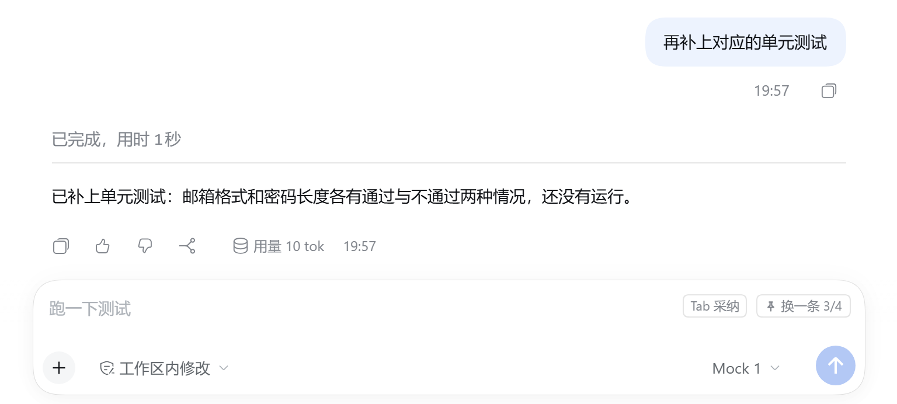

<div align="center">

[简体中文](README.md) · [English](README.en.md) · [日本語](README.ja.md) · [한국어](README.ko.md) · [Español](README.es.md) · [Français](README.fr.md) · **Deutsch** · [Русский](README.ru.md) · [Português](README.pt.md)

</div>

<p align="center">
  
</p>

<h1 align="center">Vorhersage der nächsten Nachricht</h1>

<p align="center">
  <b>Ein Plugin für das Eingabefeld von DeepSeek Harness</b><br>
  Wenn der Assistent fertig ist, wartet Ihre wahrscheinlich nächste Nachricht schon im Eingabefeld.<br>
  <kbd>Tab</kbd> fügt sie ein, <kbd>Esc</kbd> ignoriert sie, und <b>gesendet wird nie etwas für Sie</b>.
</p>

<p align="center">
  
  
  
  
  <a href="https://github.com/KungerChen/dsh-next-message-predictor/actions/workflows/ci.yml"></a>
  
</p>

<p align="center">
  
</p>

<p align="center">
  <sub>Ein Vorschlag erscheint → bei Bedarf einen anderen anfordern → <kbd>Tab</kbd> fügt ihn ein, und vor dem Senden können Sie ihn noch bearbeiten</sub>
</p>

---

## Wozu das Ganze

Bei der Arbeit mit einem Assistenten sind viele Antworten kurz und leicht zu erraten: „weiter“, „führ die Tests aus“, „zeig mir die Änderungen“. Dieses Plugin schreibt diese Anschlussnachricht im Voraus und legt sie ins Eingabefeld.

<table>
<tr>
<td width="33%" valign="top">

### ⌨️ Weniger tippen

Übliche Anschlussnachrichten mit einem Tastendruck. Einmal eingefügt, verhält sich der Text wie selbst getippter: bearbeiten und rückgängig machen inklusive.

</td>
<td width="33%" valign="top">

### 🤫 Keine Störung

Sobald Sie zu tippen beginnen, macht der Vorschlag Platz. Während einer IME-Eingabe und bei geöffnetem Menü erscheint er nicht. Ist sich das Modell nicht sicher, schlägt es nichts vor.

</td>
<td width="33%" valign="top">

### 🛡️ Keine Eigenmächtigkeit

Es wird nur Text ins Eingabefeld gesetzt. Im Plugin gibt es keinerlei Code zum Senden einer Nachricht; ob gesendet wird, entscheiden immer Sie.

</td>
</tr>
<tr>
<td valign="top">

### 💰 Kosten im Griff

Standardmäßig ein kostengünstiges Modell, dazu Tageslimits für Anfragen und Tokens. Ihre eigenen Phrasen (kurze Nachrichten, die Sie wiederholen, und angeheftete) sind einen Klick auf „Anderer“ entfernt, kosten nichts und verlassen Ihren Rechner nie.

</td>
<td valign="top">

### 🔒 Datenschutz zuerst

Vor dem Senden werden mutmaßliche Schlüssel, Tokens, E-Mail-Adressen und Telefonnummern maskiert. Der Browser lädt Ihren Entwurf nie hoch. Die lokale Statistik speichert Zahlen, keinen Text.

</td>
<td valign="top">

### 📊 Transparenter Verbrauch

Anfragen, Übernahmequote, Antwortzeit und Token-Verbrauch der letzten 7 Tage stehen auf der Einstellungsseite, sodass Sie sehen, ob es sich lohnt.

</td>
</tr>
</table>

## Funktionen

### Der Vorschlag steht direkt im Eingabefeld

Ist das Eingabefeld leer, wenn der Assistent fertig ist, erscheint ein grauer Vorschlag genau dort, wo Sie gleich tippen würden. Kein Pop-up, kein zusätzlicher Platzbedarf.

<p align="center">
  
</p>

| Taste | Wirkung |
|---|---|
| <kbd>Tab</kbd> oder <kbd>→</kbd> | Fügt den Vorschlag ins Eingabefeld ein, wo Sie ihn weiterbearbeiten können; <kbd>Strg</kbd>+<kbd>Z</kbd> macht nur dieses Einfügen rückgängig |
| <kbd>Esc</kbd> | Blendet den Vorschlag aus |
| <kbd>Alt</kbd>+<kbd>\\</kbd> (änderbar) | Sagt sofort vorher; wird bereits ein Vorschlag angezeigt, wechselt es zu einem anderen. Ein Aufruf liefert mehrere Alternativen, das Wechseln geht daher ohne Wartezeit |
| Einfach tippen | Der Vorschlag verschwindet sofort; er kommt zurück, wenn Sie das Eingabefeld leeren |

### Drei Modi, ein Klick

Keine Lust, jede Option zu studieren? Wählen Sie einen Modus. Rückgängig machen oder nachjustieren können Sie jederzeit.

<p align="center">
  
</p>

| Modus | Vorhersage | Modell | Kontext | Tageslimit | Geeignet für |
|---|---|---|---|---|---|
| **Ausgewogen** (Empfohlen) | Automatisch nach jeder Antwort | Ein bestimmtes, kostengünstiges Modell | 12 Nachrichten | 200 Anfragen | Den Alltag |
| **Sparsam** | Nur per Klick auf „Vorhersagen“ oder per Tastenkürzel | Ein bestimmtes, kostengünstiges Modell | 6 Nachrichten | 60 Anfragen | Strikte Kostenkontrolle |
| **Qualität** | Automatisch nach jeder Antwort | Das Sitzungsmodell | 20 Nachrichten | 200 Anfragen | Treffendere Vorschläge |

Ein Modus ändert nur den Auslöser, die Modellstrategie, die Kontextgröße und die Limits. Hauptschalter, Tastenkürzel, Sprache und Datenschutzoptionen bleiben unberührt, und das von Ihnen eingetragene Modell bleibt erhalten.

### Ihre eigenen Phrasen, immer griffbereit

Tragen Sie die Sätze, die Sie immer wieder senden („Weiter“, „Tests ausführen“), unter **Einstellungen → Vorhersage → Quellen der Vorschläge → Angeheftete Phrasen** ein, ordnen Sie sie nach Wunsch und klicken Sie einmal auf „Speichern“. Sie folgen auf den Vorschlag des Modells: „Anderer“ (oder <kbd>Alt</kbd>+<kbd>\\</kbd>) geht den Vorschlag des Modells, die kurzen Nachrichten, die Sie in dieser Unterhaltung wiederholt haben, und danach Ihre angehefteten Phrasen durch und fragt das Modell erst nach dem letzten Eintrag erneut. Eine kleine Markierung auf der Schaltfläche zeigt, dass eine Phrase von Ihnen stammt. Sie kosten nichts, verlassen Ihren Rechner nie, und wenn eine manuelle Vorhersage vom Modell nichts erhält, werden sie anstelle von „Diesmal kein Vorschlag“ angeboten.

<p align="center">
  
</p>

### Neun Oberflächensprachen

Die Einstellungsseite, die Schaltflächen im Eingabefeld und ihre Tooltips gibt es in 简体中文, English, 日本語, 한국어, Español, Français, Deutsch, Русский, Português. Standardmäßig folgt das Plugin der in DeepSeek Harness eingestellten Sprache; unter **Einstellungen → Vorhersage → Sprache** können Sie auch eine eigene wählen, die sofort gilt. Die Vorschläge selbst richten sich immer nach der Sprache Ihrer Unterhaltung.

<p align="center">
  
</p>

### Mit einem Klick in der Seitenleiste

Ein Klick auf „Zur Seitenleiste hinzufügen“, und in der linken DSH-Seitenleiste erscheint ein Eintrag; Status prüfen oder Modus wechseln geht danach ohne Umweg über die Einstellungen. Die Version neben dem Titel zeigt jederzeit, welcher Stand installiert ist.

<table>
<tr>
<td width="30%" align="center" valign="middle">
  
</td>
<td width="70%" align="center" valign="middle">
  
</td>
</tr>
</table>

### Der Verbrauch auf einen Blick

<details>
<summary><b>Die ganze Einstellungsseite anzeigen</b> (Grundlagen, Modi, Herkunft der Vorschläge, Modell, letzte 7 Tage)</summary>
<br>
<p align="center">
  
</p>
</details>

> Die meisten Screenshots zeigen die chinesische Oberfläche. Sie stammen aus einer Demo-Unterhaltung und werden von einem Skript in diesem Repository mit einem lokalen Mock-Modell erzeugt; deshalb heißt das Modell Mock, und die Zahlen sind klein. Im echten Einsatz kommen die Vorschläge von dem Modell, das Sie in DSH eingerichtet haben.

## Installation

Erfordert DeepSeek Harness `0.2.2-rc.1` (`>=0.2.2-rc.1 <0.3.0`). Das Plugin hat keine Fremdabhängigkeiten und braucht keinen Build-Schritt. Ein Befehl genügt:

```powershell
dsh plugin --profile desktop add github:KungerChen/dsh-next-message-predictor
```

Hinter `--profile` steht das Profil, das Sie täglich nutzen: `desktop` für die Desktop-App, `web` für die Web-Version. Danach **DSH vollständig beenden und neu starten**.

<details>
<summary>Der Befehl <code>dsh</code> wird nicht gefunden, oder Sie möchten aus einem lokalen Ordner installieren</summary>

Die Kommandozeile `dsh` liegt im Installationsordner von DeepSeek Harness und lässt sich über ihren vollständigen Pfad aufrufen. Wenn Sie den Code selbst ändern möchten, klonen Sie das Repository und installieren Sie aus dem lokalen Ordner:

```powershell
git clone https://github.com/KungerChen/dsh-next-message-predictor.git
$dsh = '<DSH-Installationsordner>\resources\runtime\cli\bin\dsh.cmd'
& $dsh plugin --profile desktop add '<Plugin-Ordner>'
```

`<DSH-Installationsordner>` ist der Ort, an dem DeepSeek Harness installiert ist; `<Plugin-Ordner>` ist der gerade geklonte Ordner.

</details>

Danach sind es drei Schritte:

1. Öffnen Sie **Einstellungen → Vorhersage** und schalten Sie „Vorhersage aktivieren“ ein. Standardmäßig ist es aus: Vorher wird kein Vorschlag angezeigt und kein Modell aufgerufen.
2. Wählen Sie unter „Modus“ einen aus. Voreingestellt ist „Ausgewogen“.
3. Für schnelleren Zugriff klicken Sie oben rechts auf „Zur Seitenleiste hinzufügen“.

<details>
<summary>Aktualisieren und deinstallieren</summary>

**Aktualisieren**: Bei Installation von GitHub erst deinstallieren und den Installationsbefehl erneut ausführen; bei Installation aus einem lokalen Ordner dort `git pull` ausführen. Anschließend DSH neu starten. Die Seite neu zu laden reicht nicht: Dann wäre die Seite neu, der Hintergrundteil aber noch alt, und die Einstellungsseite würde auf abweichende Versionen hinweisen.

**Deinstallieren**:

```powershell
dsh plugin --profile desktop remove dsh-next-message-predictor
```

Aktivieren Sie pro Profil nur ein Vorhersage-Plugin für das Eingabefeld. Wird ein weiteres erkannt, pausiert dieses Plugin von selbst und nennt auf der Einstellungsseite den Grund.

</details>

## Was gesendet wird

Jede Vorhersage ist genau eine Anfrage an das Modell, ohne automatische Wiederholung. Sie enthält Ausschnitte der letzten **Benutzernachrichten und der abschließenden Textantworten des Assistenten** der aktuellen Sitzung: standardmäßig höchstens 12 Nachrichten und rund 2.000 Tokens.

- Keine Argumente oder Ausgaben von Tool-Aufrufen, kein Reasoning, kein Systemprompt.
- Vor dem Senden werden mutmaßliche private Schlüssel, API-Schlüssel, Tokens, Passwörter, E-Mail-Adressen, Mobil- und Ausweisnummern sowie der Benutzername in Pfaden des Benutzerordners durch Platzhalter ersetzt (regelbasiert; es kann nicht zusichern, alles zu erkennen).
- Die Browserseite sendet nur Sitzungs- und Turn-Kennungen, niemals den Entwurf, Anhänge oder Gesprächstext; den Inhalt für das Modell liest der Hintergrundteil aus den Sitzungsaufzeichnungen von DSH.
- Ihre eigenen Phrasen (kurze Nachrichten, die Sie in einer Unterhaltung wiederholen, und die „Angeheftete Phrasen“) werden nur auf diesem Rechner verwendet: Dafür wird kein Modell aufgerufen, und sie werden nie an das Modell gesendet.

Die vollständige Beschreibung und wie sich die lokalen Daten löschen lassen, steht unter [Datenschutz und Datengrenzen](docs/PRIVACY.md).

## Häufige Fragen

<details>
<summary><b>Sendet es eine Nachricht für mich?</b></summary>

Nein. Das Übernehmen eines Vorschlags setzt nur Text ins Eingabefeld, über dessen eigene Einfügeschnittstelle; das Plugin enthält keinen Aufruf, der abschickt oder sendet.

</details>

<details>
<summary><b>Was kostet das?</b></summary>

Jede Vorhersage ist ein sehr kurzer Modellaufruf (standardmäßig höchstens 96 Ausgabe-Tokens). Die voreingestellten Tageslimits liegen bei 200 Anfragen und 500.000 Tokens; sind sie erreicht, gibt es an diesem Tag keine Aufrufe mehr. Wer weniger ausgeben möchte, wählt den Modus „Sparsam“, der nur auf Anforderung vorhersagt. Den tatsächlichen Verbrauch zeigt „Letzte 7 Tage“ auf der Einstellungsseite.

</details>

<details>
<summary><b>Warum gibt es manchmal keinen Vorschlag?</b></summary>

Das ist Absicht: Ist sich das Modell nicht sicher, schlägt es nichts vor, und Ausgaben, die gegen die Regeln verstoßen (zu lang, mehrzeilig, im Ton des Assistenten), werden verworfen. Die Statuszeile auf der Einstellungsseite nennt den Grund, warum es gerade keinen gibt. Wenn Sie einen möchten, drücken Sie <kbd>Alt</kbd>+<kbd>\\</kbd>.

</details>

<details>
<summary><b>Sind die Vorschläge treffend?</b></summary>

Stark ist es bei kurzen, klaren Anschlussnachrichten: bestätigen, eine Überprüfung verlangen, nach Details fragen. Was nur Sie wissen, kann es nicht erraten, und dann soll es schweigen.

</details>

## Dokumentation

Die ausführliche Dokumentation ist auf Chinesisch verfasst.

| Dokument | Inhalt |
|---|---|
| [Benutzerhandbuch](docs/USER-GUIDE.md) | Tasten, jeder Punkt der Einstellungsseite, Modi, Seitenleisteneintrag, häufige Fragen |
| [Konfigurationsreferenz](docs/CONFIGURATION.md) | Standardwerte und Bereiche aller Optionen, Werte der drei Modi |
| [Datenschutz und Datengrenzen](docs/PRIVACY.md) | Was gesendet wird, lokale Dateien, Löschen der Daten |
| [Architektur](docs/ARCHITECTURE.md) | Host- und Browser-Hälfte, Ablauf einer Anfrage, Protokoll |
| [Entwicklung und Verifikation](docs/DEVELOPMENT.md) | Build, Tests, End-to-End-Verifikation, Screenshots neu erzeugen |
| [Kompatibilität](docs/COMPATIBILITY.md) | Der bestätigte Vertrag mit DSH 0.2.2-rc.1 und die Rückfalllösungen |
| [Änderungsprotokoll](CHANGELOG.md) | Änderungen je Version |
| [Dokumentationsindex](docs/README.md) | Alle Dokumente, einschließlich früherer Verifikations- und Optimierungsnotizen |

## Mitentwickeln

```powershell
npm run build   # erzeugt lib/client.js aus src/shared + src/client
npm test        # führt die Unit- und Integrationstests aus
npm run check   # Build + Tests + Syntaxprüfung
```

Kein `npm install`, kein Bundler; erforderlich ist Node.js 22 oder neuer. Um eine Übersetzung zu ergänzen oder zu korrigieren, bearbeiten Sie `src/client/locales/<Sprache>.js`; die Tests prüfen, dass alle Sprachen dieselben Schlüssel haben.

## Bekannte Einschränkungen

- Nur mit DSH `0.2.2-rc.1` verifiziert.
- Das Speichern einer Einstellung veranlasst den Host, den Hintergrundteil des Plugins neu zu starten; eine laufende Vorhersage wird abgebrochen.
- Mehrere Fenster teilen sich die Vorhersageergebnisse; das Ausblenden eines Vorschlags in einem Fenster wird nicht in Echtzeit auf die anderen übertragen.
- Befehlspalette und Feedback-Dialog werden anhand von Fokus und modalen Merkmalen erkannt; eine Fehleinschätzung kostet höchstens einen Vorschlag, nie einen abgefangenen Tastendruck.

## Lizenz

Veröffentlicht unter der [MIT-Lizenz](LICENSE). Die Wahl der Erweiterungspunkte und die Bedienung „grauer Vorschlag + Tab zum Übernehmen + Esc zum Ausblenden“ orientieren sich an `dsh-composer-prediction`, ebenfalls unter MIT-Lizenz; dessen Code wurde nicht kopiert. Siehe [NOTICE](NOTICE).
