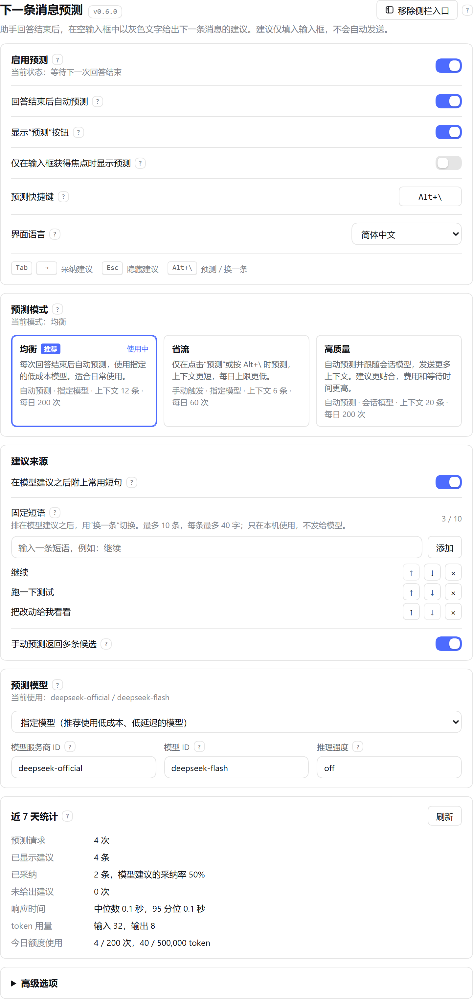

<div align="center">

[简体中文](README.md) · [English](README.en.md) · [日本語](README.ja.md) · [한국어](README.ko.md) · [Español](README.es.md) · [Français](README.fr.md) · **Deutsch** · [Русский](README.ru.md) · [Português](README.pt.md)

</div>

<p align="center">
  
</p>

<h1 align="center">Vorhersage der nächsten Nachricht</h1>

<p align="center">
  <b>Ein Plugin für das Eingabefeld von DeepSeek Harness</b><br>
  Nach einer geeigneten Antwort kann im Eingabefeld ein Vorschlag für deine nächste Nachricht erscheinen.<br>
  Fokussiere das Eingabefeld und drücke <kbd>Tab</kbd>, um den Vorschlag standardmäßig in den Entwurf zu übernehmen.
</p>

<p align="center">
  
  
  
  
  <a href="https://github.com/KungerChen/dsh-next-message-predictor/actions/workflows/ci.yml"></a>
  
</p>

<div align="center">

[Schnellstart](#quick-start) · [Vorschau und Übernahme](#suggestions) · [Eine Unterhaltung pausieren](#session-pause) · [Vorhersagemodi](#modes) · [Datenschutz und Modellanfragen](#privacy) · [Dokumentation](#documentation)

</div>

<p align="center">
  
</p>

<a name="quick-start"></a>

## Schnellstart

Das Plugin lässt sich mit DeepSeek Harness `>=0.2.2-rc.1 <0.3.0` installieren. Das Paket von GitHub ist ohne Build-Schritt einsatzbereit.

```powershell
dsh plugin --profile desktop add github:KungerChen/dsh-next-message-predictor
```

Gib dein DSH-Profil an (standardmäßig `desktop` für die App und `web` für die Web-Version). **Beende DSH vollständig und starte es neu.**

1. Öffne **Einstellungen → Vorhersage**. Bei einer neuen Installation ist die Vorhersage ausgeschaltet.
2. Wähle unter „Modus“ einen Modus. Prüfe unter „Vorhersagemodell“ den Anbieter und das Modell in DSH oder wähle „Dem Sitzungsmodell folgen“. Speichere Änderungen an den Modellfeldern.
3. Schalte „Vorhersage aktivieren“ ein und lass das Eingabefeld nach der Antwort leer. Zum manuellen Test klicke auf „Vorhersagen“ oder fokussiere das leere Eingabefeld und drücke <kbd>Alt</kbd>+<kbd>\</kbd>.

Die Modi Ausgewogen und Sparsam verwenden standardmäßig `deepseek-official / deepseek-flash`. Für ein anderes festes Modell gib die Anbieter-ID und Modell-ID aus DSH ein. Ist das eingestellte Modell nicht auflösbar, kann DSH für diese Vorhersage sein verfügbares Standardmodell verwenden.

<details>
<summary>Der Befehl <code>dsh</code> wird nicht gefunden, oder Sie möchten aus einem lokalen Ordner installieren</summary>

Die Kommandozeile `dsh` liegt im Installationsordner von DeepSeek Harness und lässt sich über ihren vollständigen Pfad aufrufen. Wenn Sie den Code selbst ändern möchten, klonen Sie das Repository und installieren Sie aus dem lokalen Ordner:

```powershell
git clone https://github.com/KungerChen/dsh-next-message-predictor.git
$dsh = '<DSH-Installationsordner>\resources\runtime\cli\bin\dsh.cmd'
& $dsh plugin --profile desktop add '<Plugin-Ordner>'
```

</details>

<details>
<summary>Aktualisieren und deinstallieren</summary>

**Eine GitHub-Installation aktualisieren**. Deinstalliere das Plugin, führe den Installationsbefehl erneut aus und starte DSH vollständig neu.

**Einen lokalen Build übernehmen**. Aktualisiere und kompiliere zuerst die Plugin-Dateien im lokalen Ordner. Wenn die Einstellungen einen noch nicht geladenen Build erkennen, wähle „Lokales Update anwenden“. DSH kann dabei auch andere geänderte Plugins im selben Profil neu laden. Starte DSH vor der ersten Verwendung oder bei fehlgeschlagener Übernahme vollständig neu.

**Deinstallieren**:

```powershell
dsh plugin --profile desktop remove dsh-next-message-predictor
```

Aktivieren Sie pro Profil nur ein Vorhersage-Plugin für das Eingabefeld. Wird ein weiteres erkannt, pausiert dieses Plugin von selbst und nennt auf der Einstellungsseite den Grund.

</details>

<a name="suggestions"></a>

## Vorschau und Übernahme

Ein verfügbarer Vorschlag erscheint grau im leeren Eingabefeld des aktiven Fensters. Standardmäßig genügt auch ein Feld ohne Fokus. Aktiviere „Vorhersagen nur anzeigen, wenn das Eingabefeld den Fokus hat“, um ihn nur bei fokussiertem Feld zu sehen. Die Option steuert die Anzeige vorhandener Vorschläge.

<p align="center">
  
</p>

| Aktion im Eingabefeld | Wirkung |
|---|---|
| <kbd>Tab</kbd>, die zugehörige Schaltfläche oder <kbd>→</kbd> am Anfang | Fokussiere zuerst das Eingabefeld. Standardmäßig landet der Vorschlag im Entwurf. Wenn du „Mit Tab senden“ aktivierst, senden Tab und die zugehörige Schaltfläche den aktuellen Vorschlag. Die Pfeiltaste nach rechts übernimmt ihn immer nur in den Entwurf. Das Senden setzt einen gültigen Vorschlag und bestandene Prüfungen voraus. Beachte vor der Aktivierung das Risiko versehentlichen Sendens. |
| <kbd>Esc</kbd> | Blendet beim fokussierten Eingabefeld den Vorschlag aus. Anschließend kannst du manuell einen neuen anfordern. |
| <kbd>Alt</kbd>+<kbd>\</kbd> (änderbar), „Vorhersagen“ oder „Anderer“ | Fordert bei leerem Eingabefeld eine Vorhersage an oder wechselt zum nächsten Vorschlag. Das Tastenkürzel erfordert zusätzlich den Fokus im Feld. |
| Einfach tippen | Sobald du tippst, verschwindet die Vorschau. Wenn du den Entwurf leerst und der Vorschlag noch gültig ist, kann er wieder erscheinen. |

Mache die Übernahme mit <kbd>Ctrl</kbd>+<kbd>Z</kbd> rückgängig oder stelle sie mit <kbd>Ctrl</kbd>+<kbd>Shift</kbd>+<kbd>Z</kbd> wieder her. Version 0.6.0 behebt das Rückgängigmachen der ersten Übernahme nach dem Senden im geprüften Editor von DSH Desktop `0.2.2-rc.3`. Andere Editor-Versionen verwenden den DSH-eigenen Verlauf. [Prüfbericht](docs/VALIDATION-DISPLAY-SESSION.md)

<a name="session-pause"></a>

## Eine Unterhaltung pausieren

Mit der Pausentaste in der Werkzeugleiste am Eingabefeld hältst du automatische und manuelle Vorhersagen für diese Unterhaltung an und blendest den Vorschlag aus. Mit ▶ setzt du sie fort und kannst dann erneut anfragen oder die nächste Antwort abwarten.

<p align="center">
  
</p>

Fenster am selben DSH-Host teilen den Pausenstatus. Er bleibt nach dem Neuladen der Seite und Speichern der Einstellungen bestehen, bis du fortsetzt oder DSH neu startest. Wird ein Vorschlag übernommen oder ausgeblendet, verschwinden die Vorschläge für diese Antwort auch in anderen Ansichten derselben Unterhaltung.

<a name="modes"></a>

## Vorhersagemodi

<p align="center">
  
</p>

| Modus | Vorhersage | Modell | Max. Kontextnachrichten | Tägliches Anfragenlimit |
|---|---|---|---|---|
| **Ausgewogen** (Empfohlen) | Automatisch nach geeigneter Antwort | Festes Modell | 12 | 200 |
| **Sparsam** | Nur manuell | Festes Modell | 6 | 60 |
| **Qualität** | Automatisch nach geeigneter Antwort | Das Sitzungsmodell | 20 | 200 |

Die Modi ändern Auslöser, Modellstrategie, Kontext und Limits. Sie behalten Hauptschalter, Tastenkürzel, Sprache, Datenschutzeinstellungen und eingetragene Modell-IDs bei.

### Modellvorschläge und eigene Phrasen

Nach den Modellvorschlägen können kurze, in dieser Unterhaltung wiederholt gesendete Nachrichten und angeheftete Phrasen folgen. Füge Phrasen unter **Einstellungen → Vorhersage → Quellen der Vorschläge → Angeheftete Phrasen** hinzu, ordne sie und speichere. „Anderer“ wechselt zwischen vorhandenen Optionen ohne weiteren Modellaufruf. Sind die vorhandenen Optionen aufgebraucht, kann die nächste Anfrage unter Einhaltung der Limits das Modell aufrufen.

Wenn das Modell bei einer manuellen Vorhersage nichts Nutzbares liefert, kann das Plugin vorhandene eigene Phrasen vorschlagen. Das Erstellen dieser Alternative braucht keinen weiteren Modellaufruf.

<p align="center">
  
</p>

## Einstellungen und Nutzung

Das Plugin hat neun Oberflächensprachen und folgt standardmäßig DSH. Unter „Sprache“ lässt sich die Sprache der Oberfläche separat einstellen.

Klicken Sie auf „Seitenleisteneintrag hinzufügen“, um Vorhersage über die linke DSH-Seitenleiste zu öffnen. Wenn Sie den Eintrag lösen, können Sie ihn unter „Mehr“ öffnen oder wieder anheften. Die installierte Version steht neben dem Titel.

<table>
<tr>
<td width="30%" align="center" valign="middle">
  
</td>
<td width="70%" align="center" valign="middle">
  
</td>
</tr>
</table>

„Letzte 7 Tage“ zeigt Anfragen, angezeigte und übernommene Vorschläge, Antwortzeiten und Tokenverbrauch.

<details>
<summary><b>Die ganze Einstellungsseite anzeigen</b> (Grundlagen, Modi, Herkunft der Vorschläge, Modell, letzte 7 Tage)</summary>

<p align="center">
  
</p>

<p align="center">
  
</p>

</details>

> Die Screenshots stammen aus einer isolierten Web-Oberfläche mit synthetischer Unterhaltung und einem lokal simulierten Modell. Die Einstellungen sind Beispiele. Die Angaben zu Verbrauch und Antwortzeit dienen als Beispiel.

<a name="privacy"></a>

## Datenschutz und Modellanfragen

Bei einer Modellvorhersage gehen aktuelle Auszüge aus **Benutzernachrichten und endgültigen Assistentenantworten** des aktiven Gesprächszweigs an einen in DSH eingerichteten Anbieter. Standardmäßig ist die Eingabe auf 12 Nachrichten und etwa 2000 Token inklusive Anweisungen begrenzt.

- Standardmäßig ist eine kurze Zusammenfassung der Aktivitätszahlen der vorherigen Runde enthalten. Werkzeugargumente, Werkzeugausgaben, Gedankengänge und Systemanweisungen bleiben außen vor.
- Die regelbasierte Maskierung ist standardmäßig aktiv. Sie ersetzt mutmaßliche Geheimnisse und bestimmte personenbezogene Angaben. Sensible Texte können unerkannt bleiben.
- Anfragen des Browsers für Vorhersage und Gesprächsstatus enthalten Kennungen und Metadaten. Der Hintergrunddienst liest gesendete Nachrichten aus DSH. Entwürfe, Anhänge und Referenzen sind ausgeschlossen. Lokale Statistiken speichern Zähler, Zeiten und Kennungen ohne den Text von Gesprächen oder Vorschlägen.
- Lokale Kandidaten und die Liste angehefteter Phrasen werden der Modellanweisung nicht hinzugefügt. Eine bereits als Nachricht gesendete Phrase kann im aktuellen Gesprächskontext erscheinen.

Die vollständige Beschreibung und wie sich die lokalen Daten löschen lassen, steht unter [Datenschutz und Datengrenzen](docs/PRIVACY.md).

## Häufige Fragen

<details>
<summary><b>Warum ist kein Vorschlag zu sehen?</b></summary>

Prüfe den aktuellen Status in den Einstellungen. Eine Pause, ein inaktives Fenster, ein vorhandener Entwurf, ein offenes Menü oder laufende IME-Eingabe können die Anzeige verhindern. Auch das Modell kann ohne brauchbaren Vorschlag antworten. Wenn die Unterhaltung die Bedingungen erfüllt, versuche es manuell im leeren, fokussierten Feld.

</details>

<details>
<summary><b>Wann entstehen Kosten?</b></summary>

Der Preis hängt vom aufgerufenen Anbieter und dem Tokenverbrauch ab. Ein Wechsel vorhandener Optionen oder das Erstellen einer lokalen Alternative führt zu keiner weiteren Modellanfrage. Im Sparmodus fragst du Vorhersagen nur bei Bedarf an.

</details>

<a name="documentation"></a>

## Dokumentation

Kompatibilität und Prüfungen für 0.7.0 stehen unter [Veröffentlichung und Einrichtung](docs/RELEASE.md#release-validation-070). Die ausführliche Dokumentation ist auf Chinesisch verfasst.

| Dokument | Inhalt |
|---|---|
| [Benutzerhandbuch](docs/USER-GUIDE.md) | Tasten, jeder Punkt der Einstellungsseite, Modi, Seitenleisteneintrag, häufige Fragen |
| [Konfigurationsreferenz](docs/CONFIGURATION.md) | Standardwerte und Bereiche aller Optionen, Werte der drei Modi |
| [Datenschutz und Datengrenzen](docs/PRIVACY.md) | Was gesendet wird, lokale Dateien, Löschen der Daten |
| [Kompatibilität](docs/COMPATIBILITY.md) | DSH-Versionen, Testumfang und Host-Schnittstellen |
| [Änderungsprotokoll](CHANGELOG.md) | Änderungen je Version |
| [Dokumentationsindex](docs/README.md) | Alle Dokumente, einschließlich früherer Verifikations- und Optimierungsnotizen |

## Mitentwickeln

```powershell
npm run build
npm test
npm run check
```

Für die Entwicklung ist Node.js 22 oder neuer erforderlich. Laufzeitabhängigkeiten müssen nicht installiert werden. `npm run check` prüft das Client-Bundle, die generierten READMEs, die Tests und die JavaScript-Syntax. [Entwicklung und Verifikation](docs/DEVELOPMENT.md) · [Architektur](docs/ARCHITECTURE.md)

## Lizenz

Veröffentlicht unter der [MIT-Lizenz](LICENSE). Die Wahl der Erweiterungspunkte und die Bedienung „grauer Vorschlag + Tab zum Übernehmen + Esc zum Ausblenden“ orientieren sich an `dsh-composer-prediction`, ebenfalls unter MIT-Lizenz; dessen Code wurde nicht kopiert. Siehe [NOTICE](NOTICE).
