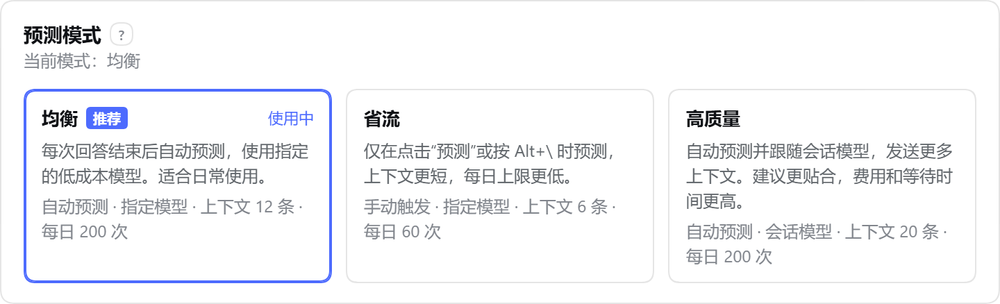
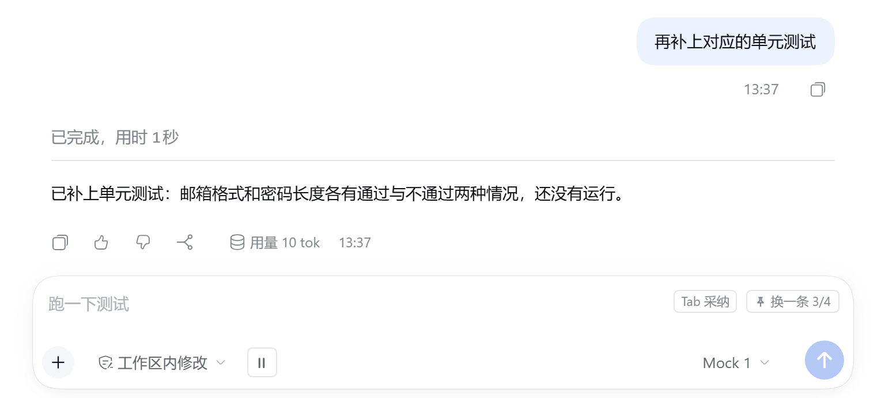
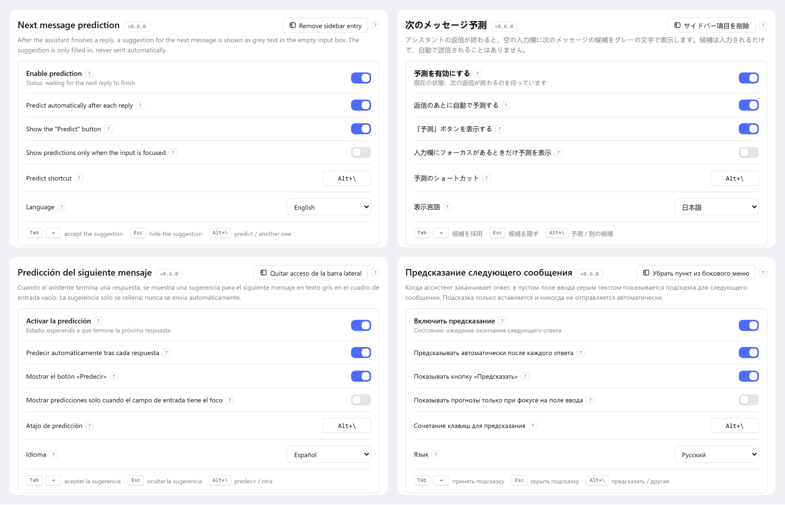

<div align="center">

[简体中文](README.md) · [English](README.en.md) · [日本語](README.ja.md) · [한국어](README.ko.md) · **Español** · [Français](README.fr.md) · [Deutsch](README.de.md) · [Русский](README.ru.md) · [Português](README.pt.md)

</div>

<p align="center">
  
</p>

<h1 align="center">Predicción del siguiente mensaje</h1>

<p align="center">
  <b>Un plugin para el cuadro de entrada de DeepSeek Harness</b><br>
  Después de una respuesta que cumple las condiciones, puedes ver una sugerencia para tu próximo mensaje en el cuadro de texto.<br>
  Enfoca el cuadro y pulsa <kbd>Tab</kbd> para pasar la sugerencia al borrador. Tú decides cuándo enviarlo.
</p>

<p align="center">
  
  
  
  
  <a href="https://github.com/KungerChen/dsh-next-message-predictor/actions/workflows/ci.yml"></a>
  
</p>

<div align="center">

[Inicio rápido](#quick-start) · [Previsualizar y aceptar](#suggestions) · [Pausar una conversación](#session-pause) · [Modos de predicción](#modes) · [Privacidad y solicitudes al modelo](#privacy) · [Documentación](#documentation)

</div>

<p align="center">
  
</p>

<a name="quick-start"></a>

## Inicio rápido

Se instala en DeepSeek Harness `>=0.2.2-rc.1 <0.3.0`. El paquete de GitHub está listo para instalar y no requiere compilación.

```powershell
dsh plugin --profile desktop add github:KungerChen/dsh-next-message-predictor
```

Indica el perfil que usas en DSH (por defecto, `desktop` para la aplicación y `web` para la versión web). Después **cierra DSH por completo y vuelve a abrirlo**.

1. Abre **Ajustes → Predicción**. La predicción está desactivada tras la primera instalación.
2. Elige un modo en «Modo». En «Modelo de predicción», comprueba el proveedor y el modelo configurados en DSH, o selecciona «Seguir el modelo de la sesión». Guarda los cambios en los campos del modelo.
3. Activa «Activar la predicción». Deja vacío el cuadro después de la respuesta. Para probarlo manualmente, pulsa «Predecir» o enfoca el cuadro vacío y pulsa <kbd>Alt</kbd>+<kbd>\</kbd>.

Los modos equilibrado y ahorro usan por defecto `deepseek-official / deepseek-flash`. Para otro modelo específico, introduce sus ID de proveedor y modelo en DSH. Si DSH no puede resolver el modelo configurado, puede usar su modelo predeterminado disponible para esa predicción.

<details>
<summary>No se encuentra el comando <code>dsh</code>, o quieres instalar desde una carpeta local</summary>

La línea de comandos `dsh` está en la carpeta de instalación de DeepSeek Harness y se puede invocar por su ruta completa. Si quieres modificar el código, clona el repositorio e instala desde la carpeta local:

```powershell
git clone https://github.com/KungerChen/dsh-next-message-predictor.git
$dsh = '<carpeta de instalación de DSH>\resources\runtime\cli\bin\dsh.cmd'
& $dsh plugin --profile desktop add '<carpeta del plugin>'
```

</details>

<details>
<summary>Actualizar y desinstalar</summary>

**Actualizar**: si instalaste desde GitHub, desinstala y vuelve a ejecutar el comando de instalación; si instalaste desde una carpeta local, ejecuta `git pull` en ella. Después reinicia DSH. Recargar la página no basta: la página sería nueva y la parte en segundo plano seguiría siendo antigua, y la página de ajustes avisaría de que las versiones no coinciden.

**Desinstalar**:

```powershell
dsh plugin --profile desktop remove dsh-next-message-predictor
```

Activa un solo plugin de predicción para el cuadro de entrada por perfil. Si se detecta otro, este plugin se pausa solo y explica el motivo en la página de ajustes.

</details>

<a name="suggestions"></a>

## Previsualizar y aceptar

Las sugerencias disponibles se muestran en gris en el cuadro vacío de la ventana activa. Por defecto aparecen incluso sin el foco en el cuadro. Activa «Mostrar predicciones solo cuando el campo de entrada tiene el foco» para verlas solo cuando el cuadro tiene el foco. Esta opción controla la visualización de las sugerencias disponibles.

<p align="center">
  
</p>

| Acción en el cuadro de texto | Qué hace |
|---|---|
| <kbd>Tab</kbd>, <kbd>→</kbd> al inicio o clic en «Tab: aceptar» | Enfoca primero el cuadro. La sugerencia pasa al borrador y puedes editarla antes de enviarlo. |
| <kbd>Esc</kbd> | Con el cuadro enfocado, oculta la sugerencia actual. Después puedes pedir otra manualmente. |
| <kbd>Alt</kbd>+<kbd>\</kbd> (configurable), «Predecir» o «Otra» | Con el cuadro vacío, pide una predicción o cambia de sugerencia. El atajo también requiere que el cuadro tenga el foco. |
| Escribir sin más | Al escribir se oculta la sugerencia. Si vacías el borrador y la sugerencia sigue vigente, puede volver a mostrarse. |

Después de aceptar, pulsa <kbd>Ctrl</kbd>+<kbd>Z</kbd> para deshacer y <kbd>Ctrl</kbd>+<kbd>Shift</kbd>+<kbd>Z</kbd> para rehacer. La versión 0.6.0 corrige el deshacer de la primera inserción tras enviar un mensaje en el editor probado de DSH Desktop `0.2.2-rc.3`. Las otras versiones usan el historial nativo de DSH. [Informe de validación](docs/VALIDATION-DISPLAY-SESSION.md)

<a name="session-pause"></a>

## Pausar una conversación

El botón de pausa de la barra del cuadro detiene la predicción automática y manual en esta conversación y oculta la sugerencia. Para reanudar, pulsa ▶. Luego puedes pedir una predicción o esperar a la siguiente respuesta.

<p align="center">
  
</p>

Las ventanas conectadas al mismo host de DSH comparten el estado de pausa. Se conserva al recargar la página y guardar los ajustes, hasta que reanudes las predicciones o reinicies DSH. Aceptar u ocultar una sugerencia también oculta las de ese turno en las demás vistas de la conversación.

<a name="modes"></a>

## Modos de predicción

<p align="center">
  
</p>

| Modo | Cuándo predice | Modelo | Máx. mensajes de contexto | Límite diario de solicitudes |
|---|---|---|---|---|
| **Equilibrado** (Recomendado) | Automática tras una respuesta apta | Modelo específico | 12 | 200 |
| **Ahorro** | Solo manual | Modelo específico | 6 | 60 |
| **Calidad** | Automática tras una respuesta apta | El modelo de la sesión | 20 | 200 |

Los modos cambian el disparador, la estrategia de modelo, el contexto y los límites. Conservan el interruptor general, el atajo, el idioma, los ajustes de privacidad y los ID de modelo que hayas introducido.

### Sugerencias del modelo y frases propias

Después de las sugerencias del modelo pueden aparecer los mensajes cortos que repetiste en esta conversación y las frases fijadas. Añade u ordena las frases en **Ajustes → Predicción → Origen de las sugerencias → Frases fijadas** y guarda. «Otra» recorre las opciones disponibles sin hacer otra llamada al modelo. Al agotar las opciones, pedir otra puede generar una solicitud al modelo, sujeta a los límites.

Si el modelo no da un resultado utilizable en una petición manual, el complemento puede ofrecer tus frases si las hay. Generar esta alternativa no requiere otra llamada al modelo.

<p align="center">
  
</p>

## Ajustes y uso

La interfaz está disponible en nueve idiomas. Por defecto sigue el de DSH. Puedes elegir otro en «Idioma» en los ajustes del complemento.

Pulsa «Añadir acceso a la barra lateral» para abrir Predicción desde la barra lateral izquierda de DSH. Si quitas la fijación, puedes abrir el acceso o volver a fijarlo desde «Más». La versión instalada aparece junto al título.

<table>
<tr>
<td width="30%" align="center" valign="middle">
  
</td>
<td width="70%" align="center" valign="middle">
  
</td>
</tr>
</table>

«Últimos 7 días» muestra solicitudes, sugerencias mostradas y aceptadas, tiempos de respuesta y uso de tokens.

<details>
<summary><b>Ver la página de ajustes completa</b> (básico, modos, origen de las sugerencias, modelo, últimos 7 días)</summary>

<p align="center">
  
</p>

<p align="center">
  
</p>

</details>

> Las capturas se tomaron en una interfaz web aislada con una conversación sintética y un modelo simulado local. Los ajustes son de ejemplo. Las cifras de uso y tiempo son ilustrativas.

<a name="privacy"></a>

## Privacidad y solicitudes al modelo

La predicción envía fragmentos recientes de **mensajes del usuario y respuestas finales del asistente** de la rama actual a un proveedor configurado en DSH. El límite de entrada predeterminado es de 12 mensajes y unos 2000 tokens, incluidas las instrucciones de predicción.

- Por defecto se incluye un breve resumen de los recuentos de actividad del turno anterior. Se excluyen los argumentos y resultados de herramientas, el razonamiento y las instrucciones del sistema.
- El enmascarado por reglas está activado por defecto. Sustituye posibles secretos y algunos identificadores personales. Puede pasar por alto texto sensible.
- Las solicitudes de predicción y estado enviadas desde el navegador incluyen identificadores y metadatos. El backend lee los mensajes enviados desde DSH. Se excluyen borradores, adjuntos y referencias. Las estadísticas locales guardan recuentos, tiempos e identificadores y omiten el texto de conversaciones y sugerencias.
- Las opciones locales y la lista de frases fijadas no se añaden a las instrucciones del modelo. Una frase ya enviada como mensaje sí puede aparecer en el contexto reciente.

La descripción completa, y cómo borrar los datos locales, está en [Privacidad y límites de los datos](docs/PRIVACY.md).

## Preguntas frecuentes

<details>
<summary><b>¿Por qué no aparece una sugerencia?</b></summary>

Consulta el estado en los ajustes. Una conversación en pausa, una ventana inactiva, un borrador con texto, un menú abierto o un IME en composición pueden impedir que aparezca una sugerencia. El modelo también puede devolver un resultado inutilizable. Si se cumplen las condiciones, prueba la predicción manual con el cuadro vacío y enfocado.

</details>

<details>
<summary><b>¿Cuándo se cobra una solicitud?</b></summary>

El coste depende del proveedor que recibe la solicitud y de los tokens que usa. Cambiar entre opciones disponibles y generar una alternativa local no añade solicitudes al modelo. Con el modo de ahorro, puedes pedir predicciones cuando las necesites.

</details>

<a name="documentation"></a>

## Documentación

La documentación detallada está escrita en chino.

| Documento | Contenido |
|---|---|
| [Guía de uso](docs/USER-GUIDE.md) | Teclas, cada elemento de la página de ajustes, modos, la entrada de la barra lateral, preguntas frecuentes |
| [Referencia de configuración](docs/CONFIGURATION.md) | Valores predeterminados e intervalos de todas las opciones, valores de los tres modos |
| [Privacidad y límites de los datos](docs/PRIVACY.md) | Qué se envía, archivos locales, cómo borrar los datos |
| [Compatibilidad](docs/COMPATIBILITY.md) | Versiones de DSH, cobertura de pruebas e interfaces del host |
| [Registro de cambios](CHANGELOG.md) | Cambios de cada versión |
| [Índice de la documentación](docs/README.md) | Todos los documentos, incluidas las notas anteriores de verificación y optimización |

## Contribuir

```powershell
npm run build
npm test
npm run check
```

Para desarrollar necesitas Node.js 22 o posterior. No hay dependencias de ejecución que instalar. `npm run check` comprueba el paquete cliente, los README generados, las pruebas y la sintaxis de JavaScript. [Desarrollo y verificación](docs/DEVELOPMENT.md) · [Arquitectura](docs/ARCHITECTURE.md)

## Licencia

Publicado bajo la [licencia MIT](LICENSE). La elección de los puntos de extensión y la interacción «sugerencia gris + Tab para aceptar + Esc para ocultar» se inspiran en `dsh-composer-prediction`, también con licencia MIT; no se ha copiado su código. Consulta [NOTICE](NOTICE).
