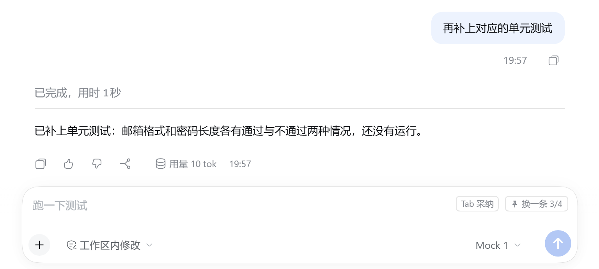

<div align="center">

[简体中文](README.md) · [English](README.en.md) · **日本語** · [한국어](README.ko.md) · [Español](README.es.md) · [Français](README.fr.md) · [Deutsch](README.de.md) · [Русский](README.ru.md) · [Português](README.pt.md)

</div>

<p align="center">
  
</p>

<h1 align="center">次のメッセージ予測</h1>

<p align="center">
  <b>DeepSeek Harness の入力欄プラグイン</b><br>
  アシスタントの回答が終わると、次に言いたいことがもう入力欄で待っています。<br>
  <kbd>Tab</kbd> で挿入、<kbd>Esc</kbd> で無視。<b>勝手に送信することはありません</b>。
</p>

<p align="center">
  
  
  
  
  <a href="https://github.com/KungerChen/dsh-next-message-predictor/actions/workflows/ci.yml"></a>
  
</p>

<p align="center">
  
</p>

<p align="center">
  <sub>候補が表示される → 合わなければ別の候補へ → <kbd>Tab</kbd> で挿入。送信前に自由に編集できます</sub>
</p>

---

## なぜ使うのか

アシスタントと作業していると、返事の多くは短く、予想しやすいものです。「続けて」「テストを実行して」「変更内容を見せて」。このプラグインはそうした次の一言を先に書いて、入力欄に置いておきます。

<table>
<tr>
<td width="33%" valign="top">

### ⌨️ 入力が減る

よくある返事をキーひとつで挿入。挿入後は自分で打った文字と同じで、編集も取り消しもできます。

</td>
<td width="33%" valign="top">

### 🤫 邪魔をしない

入力を始めた瞬間に候補は引っ込みます。IME の変換中やメニューを開いている間は表示されません。モデルに確信がないときは何も出しません。

</td>
<td width="33%" valign="top">

### 🛡️ 出しゃばらない

行うのは入力欄に文字を入れることだけ。プラグインには「メッセージを送信する」コードが一切なく、送るかどうかは常にあなたが決めます。

</td>
</tr>
<tr>
<td valign="top">

### 💰 コストを管理できる

既定では低コストのモデルを使い、1 日のリクエスト数とトークン数に上限があります。自分のフレーズ（繰り返し送る短いメッセージと固定フレーズ）は「別の候補」を押すだけで取り出せ、費用はかからず、パソコンの外にも出ません。

</td>
<td valign="top">

### 🔒 プライバシー重視

送信前に、キー、トークン、メールアドレス、電話番号らしきものを伏せます。ブラウザーが下書きをアップロードすることはありません。ローカルの統計は数値のみで、文章は記録しません。

</td>
<td valign="top">

### 📊 使用量が見える

直近 7 日間のリクエスト数、採用率、応答時間、トークン使用量を設定ページで確認でき、使う価値があるかひと目で分かります。

</td>
</tr>
</table>

## 機能

### 候補は入力欄の中に

アシスタントの回答が終わったとき入力欄が空なら、これから打とうとするその場所にグレーの候補が表示されます。ポップアップも余分なスペースもありません。

<p align="center">
  
</p>

| 操作 | 動作 |
|---|---|
| <kbd>Tab</kbd> または <kbd>→</kbd> | 候補を入力欄に挿入します。そのまま編集でき、<kbd>Ctrl</kbd>+<kbd>Z</kbd> はこの挿入だけを取り消します |
| <kbd>Esc</kbd> | 候補を非表示にします |
| <kbd>Alt</kbd>+<kbd>\\</kbd>（変更可） | すぐに予測します。候補が表示中なら別の候補に切り替えます。1 回の呼び出しで複数の候補を受け取るので、切り替えに待ち時間はありません |
| そのまま入力する | 候補はすぐに消えます。入力欄を空にすると戻ってきます |

### 3 つのモードをワンクリックで

設定項目をひとつずつ調べたくない場合は、モードを選ぶだけ。いつでも元に戻したり微調整したりできます。

<p align="center">
  
</p>

| モード | 予測のタイミング | モデル | コンテキスト | 1 日の上限 | 向いている用途 |
|---|---|---|---|---|---|
| **バランス**（推奨） | 回答のたびに自動 | 指定した低コストのモデル | 12 件 | 200 回 | 日常の利用 |
| **節約** | 「予測」を押すかショートカットを使ったときだけ | 指定した低コストのモデル | 6 件 | 60 回 | コストを厳しく抑えたい |
| **高品質** | 回答のたびに自動 | セッションのモデル | 20 件 | 200 回 | より的確な候補がほしい |

モードが変更するのは、予測のきっかけ、モデルの方針、コンテキストの量、上限だけです。メインスイッチ、ショートカット、言語、プライバシーの設定には触れず、入力済みのモデルも上書きしません。

### 自分のフレーズを、すぐ手元に

何度も送る言葉（「続けて」「テストを実行して」など）を **設定 → メッセージ予測 → 候補の出どころ → 固定フレーズ** に追加し、好きな順に並べて、「保存」を 1 回押します。固定フレーズはモデルの候補のあとに続きます。「別の候補」（または <kbd>Alt</kbd>+<kbd>\\</kbd>）を押すと、モデルの候補、この会話で繰り返し送った短いメッセージ、固定フレーズの順に切り替わり、最後まで進んで初めてモデルに再び問い合わせます。ボタンの小さなマークは、それが自分のフレーズであることを示します。費用はかからず、パソコンの外には出ません。手動予測でモデルから候補が得られなかったときは、「今回は候補がありません」の代わりにこれらが提示されます。

<p align="center">
  
</p>

### 9 つの表示言語

設定ページ、入力欄のボタン、そのツールチップは 简体中文、English、日本語、한국어、Español、Français、Deutsch、Русский、Português で表示できます。既定では DeepSeek Harness の言語に従います。**設定 → メッセージ予測 → 表示言語** で個別に選ぶこともでき、すぐに反映されます。候補そのものの言語は、常に会話の言語に合わせます。

<p align="center">
  
</p>

### サイドバーからワンクリック

「サイドバーに追加」を押すと、DSH の左サイドバーに項目が追加されます。以後は設定を開かなくても、状態の確認やモードの切り替えができます。タイトル横のバージョン番号で、どの版が入っているかいつでも分かります。

<table>
<tr>
<td width="30%" align="center" valign="middle">
  
</td>
<td width="70%" align="center" valign="middle">
  
</td>
</tr>
</table>

### どれだけ使ったかがひと目で分かる

<details>
<summary><b>設定ページ全体を表示</b>（基本、モード、候補の出どころ、モデル、直近 7 日間）</summary>
<br>
<p align="center">
  
</p>
</details>

> スクリーンショットの多くは中国語の画面です。デモ用の会話から、このリポジトリのスクリプトがローカルの模擬モデルを使って自動生成したもので、そのためモデル名は Mock、統計の数値も小さくなっています。実際の利用では、DSH で設定したモデルが候補を生成します。

## インストール

DeepSeek Harness `0.2.2-rc.1`（`>=0.2.2-rc.1 <0.3.0`）が必要です。外部依存はなく、ビルドも不要です。コマンドひとつで導入できます：

```powershell
dsh plugin --profile desktop add github:KungerChen/dsh-next-message-predictor
```

`--profile` の後ろは普段使っているプロファイルです。デスクトップ版は `desktop`、Web 版は `web`。導入後は **DSH を完全に終了してから起動し直してください**。

<details>
<summary><code>dsh</code> コマンドが見つからない、またはローカルのフォルダーから導入したい場合</summary>

`dsh` コマンドは DeepSeek Harness のインストール先にあり、フルパスで呼び出せます。コードを自分で変更したい場合は、クローンしてからローカルのフォルダーを指定して導入します：

```powershell
git clone https://github.com/KungerChen/dsh-next-message-predictor.git
$dsh = '<DSH のインストール先>\resources\runtime\cli\bin\dsh.cmd'
& $dsh plugin --profile desktop add '<プラグインのフォルダー>'
```

`<DSH のインストール先>` は DeepSeek Harness をインストールした場所、`<プラグインのフォルダー>` はクローンしたフォルダーです。

</details>

あとは 3 ステップで使い始められます：

1. **設定 → メッセージ予測** を開き、「予測を有効にする」をオンにします。既定ではオフで、有効にするまで候補は表示されず、モデルも呼び出されません。
2. 「予測モード」でひとつ選びます。既定は「バランス」です。
3. もっと手早く開きたければ、右上の「サイドバーに追加」を押します。

<details>
<summary>更新とアンインストール</summary>

**更新**：GitHub から導入した場合は、いったんアンインストールして上のインストールコマンドをもう一度実行します。ローカルのフォルダーから導入した場合は、そのフォルダーで `git pull` します。そのあと DSH を再起動してください。ページを再読み込みするだけでは不十分です。ページだけが新しくバックグラウンド側は古いままになり、設定ページにバージョンの不一致が表示されます。

**アンインストール**：

```powershell
dsh plugin --profile desktop remove dsh-next-message-predictor
```

1 つのプロファイルで有効にする入力欄予測プラグインは 1 つだけにしてください。同種のプラグインを検出すると、このプラグインは自動的に一時停止し、設定ページに理由を表示します。

</details>

## 何を送信するか

予測 1 回につきモデルへのリクエストは 1 回で、自動の再試行はありません。内容は、現在のセッションの直近の**ユーザーのメッセージとアシスタントの最終的なテキスト回答**の抜粋で、既定では最大 12 件、約 2,000 トークンです。

- ツール呼び出しの引数と出力、推論の過程、システムプロンプトは含みません。
- 送信前に、秘密鍵、API キー、トークン、パスワード、メールアドレス、携帯電話番号、身分証番号、ホームフォルダーのパスに含まれるユーザー名らしきものをプレースホルダーに置き換えます（規則に基づく処理であり、すべてを検出できる保証はありません）。
- ブラウザーのページが送るのはセッションとターンの識別子だけで、下書き、添付ファイル、会話の文章は送りません。モデルに渡す内容は、バックグラウンド側が DSH 自身のセッション記録から読み取ります。
- 自分のフレーズ（会話で繰り返し送った短いメッセージと「固定フレーズ」）はこのコンピューター上だけで使われ、モデルは呼び出さず、モデルに送ることもありません。

詳しい説明とローカルのデータを削除する方法は、[プライバシーとデータの境界](docs/PRIVACY.md) にあります。

## よくある質問

<details>
<summary><b>勝手にメッセージを送信しませんか？</b></summary>

しません。候補の採用は、入力欄自身の挿入インターフェースを使って文字を入れるだけです。プラグインのコードに、送信や確定を行う呼び出しはありません。

</details>

<details>
<summary><b>費用はどのくらいですか？</b></summary>

予測 1 回はごく短いモデル呼び出しです（既定では出力は最大 96 トークン）。既定の 1 日の上限は 200 回、50 万トークンで、達するとその日はもう呼び出しません。さらに抑えたい場合は「節約」モードを選ぶと、自分で求めたときだけ予測します。実際の使用量は設定ページの「直近 7 日間」で確認できます。

</details>

<details>
<summary><b>候補が出ないことがあるのはなぜですか？</b></summary>

仕様です。モデルに確信がないときは何も出さず、条件に合わない出力（長すぎる、複数行、アシスタントの口調）も破棄します。設定ページの状態の行に、いま候補がない理由が表示されます。候補がほしいときは <kbd>Alt</kbd>+<kbd>\\</kbd> を押してください。

</details>

<details>
<summary><b>候補は的確ですか？</b></summary>

得意なのは、短くはっきりした次の一言です。続行の確認、検証の依頼、詳細の質問など。あなたにしか分からないことは当てられません。その場合は黙っているのが正しい動作です。

</details>

## ドキュメント

詳細なドキュメントは中国語で書かれています。

| ドキュメント | 内容 |
|---|---|
| [利用ガイド](docs/USER-GUIDE.md) | キー操作、設定ページの各項目、モード、サイドバーの項目、よくある質問 |
| [設定リファレンス](docs/CONFIGURATION.md) | すべての設定項目の既定値と範囲、3 つのモードの値 |
| [プライバシーとデータの境界](docs/PRIVACY.md) | 送信する範囲、ローカルのファイル、データの削除方法 |
| [アーキテクチャ](docs/ARCHITECTURE.md) | Host 側とブラウザー側の構成、リクエストの流れ、プロトコル |
| [開発と検証](docs/DEVELOPMENT.md) | ビルド、テスト、エンドツーエンドの検証、スクリーンショットの再生成 |
| [互換性](docs/COMPATIBILITY.md) | DSH 0.2.2-rc.1 との契約の確認と代替動作 |
| [変更履歴](CHANGELOG.md) | 各バージョンの変更点 |
| [ドキュメント一覧](docs/README.md) | 過去の検証と最適化の記録を含む、すべてのドキュメント |

## 開発に参加する

```powershell
npm run build   # src/shared + src/client から lib/client.js を生成
npm test        # 単体・結合テストを実行
npm run check   # ビルド + テスト + 構文チェック
```

`npm install` は不要で、バンドラーも使いません。Node.js 22 以降が必要です。翻訳の追加や修正は `src/client/locales/<言語>.js` を編集してください。すべての言語でキーがそろっていることはテストが確認します。

## 既知の制限

- 検証済みなのは DSH `0.2.2-rc.1` のみです。
- 設定を保存すると、ホストがプラグインのバックグラウンド側を再起動し、進行中の予測は取り消されます。
- 複数のウィンドウは予測結果を共有します。あるウィンドウで候補を非表示にしても、他のウィンドウにはすぐには反映されません。
- コマンドパレットとフィードバックのダイアログは、フォーカスとモーダルの特徴で判定します。判定を誤っても候補が 1 回表示されないだけで、キー入力を奪うことはありません。

## ライセンス

[MIT ライセンス](LICENSE) で公開しています。拡張ポイントの選び方と「グレーの候補 + Tab で採用 + Esc で非表示」という操作は、同じく MIT ライセンスの `dsh-composer-prediction` を参考にしました。コードは複製していません。出典は [NOTICE](NOTICE) を参照してください。
