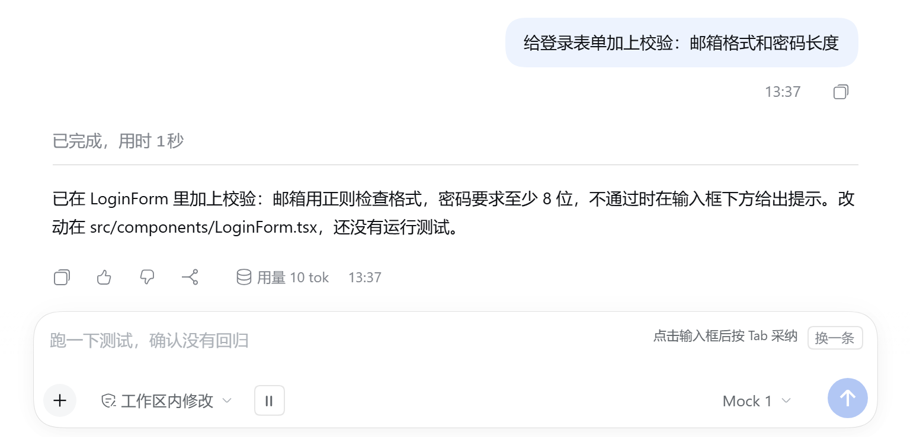
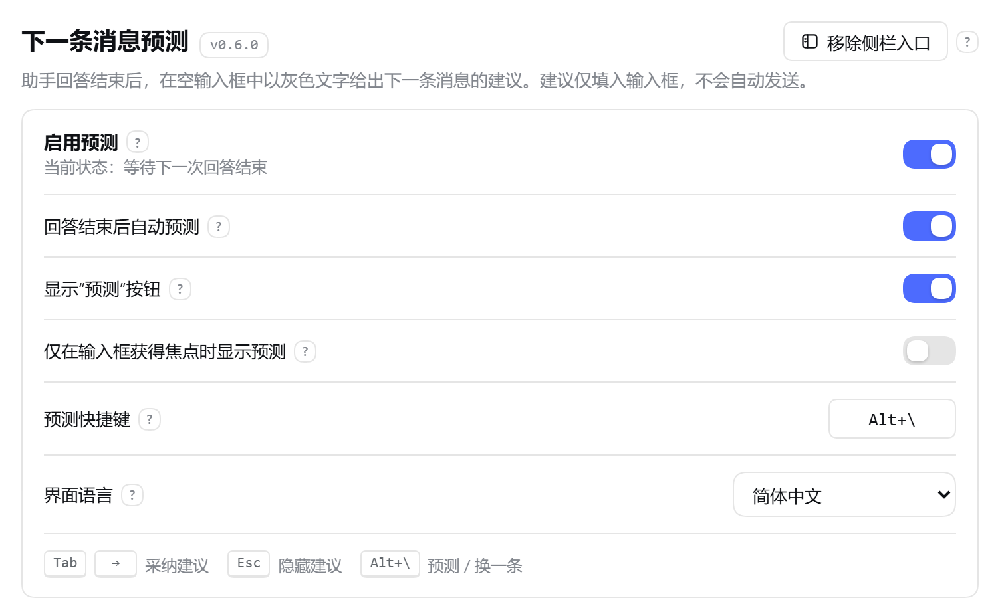

<div align="center">

[简体中文](README.md) · [English](README.en.md) · **日本語** · [한국어](README.ko.md) · [Español](README.es.md) · [Français](README.fr.md) · [Deutsch](README.de.md) · [Русский](README.ru.md) · [Português](README.pt.md)

</div>

<p align="center">
  
</p>

<h1 align="center">次のメッセージ予測</h1>

<p align="center">
  <b>DeepSeek Harness の入力欄プラグイン</b><br>
  条件を満たす応答の後、次に送るメッセージの候補を入力欄で確認できます。<br>
  入力欄にフォーカスして <kbd>Tab</kbd> を押すと、既定では下書きに入ります。
</p>

<p align="center">
  
  
  
  
  <a href="https://github.com/KungerChen/dsh-next-message-predictor/actions/workflows/ci.yml"></a>
  
</p>

<div align="center">

[はじめに](#quick-start) · [候補の表示と採用](#suggestions) · [会話の予測を一時停止](#session-pause) · [予測モード](#modes) · [プライバシーとモデルへの送信](#privacy) · [ドキュメント](#documentation)

</div>

<p align="center">
  
</p>

<a name="quick-start"></a>

## はじめに

インストール対象は DeepSeek Harness `>=0.2.2-rc.1 <0.3.0` です。GitHub からインストールすればビルドは不要です。

```powershell
dsh plugin --profile desktop add github:KungerChen/dsh-next-message-predictor
```

普段使うプロファイルを指定してください（既定ではデスクトップ版は `desktop`、Web 版は `web`）。インストール後は **DSH を完全に終了して起動し直してください**。

1. **設定 → メッセージ予測** を開きます。初回インストール時は予測が無効です。
2. 「予測モード」でモードを選び、「予測に使うモデル」で DSH に登録済みのプロバイダーとモデルを確認するか、「セッションのモデルに合わせる」を選びます。モデルの入力欄を変更したら保存してください。
3. 「予測を有効にする」をオンにし、応答後に入力欄を空にしておきます。手動で試すには「予測」を押すか、空の入力欄にフォーカスして <kbd>Alt</kbd>+<kbd>\</kbd> を押します。

バランスと節約の既定の指定先は `deepseek-official / deepseek-flash` です。別のモデルを指定する場合は DSH のプロバイダー ID とモデル ID を入力します。指定モデルを解決できない場合、その回は利用可能な DSH の既定モデルを使うことがあります。

<details>
<summary><code>dsh</code> コマンドが見つからない、またはローカルのフォルダーから導入したい場合</summary>

`dsh` コマンドは DeepSeek Harness のインストール先にあり、フルパスで呼び出せます。コードを自分で変更したい場合は、クローンしてからローカルのフォルダーを指定して導入します：

```powershell
git clone https://github.com/KungerChen/dsh-next-message-predictor.git
$dsh = '<DSH のインストール先>\resources\runtime\cli\bin\dsh.cmd'
& $dsh plugin --profile desktop add '<プラグインのフォルダー>'
```

</details>

<details>
<summary>更新とアンインストール</summary>

**GitHub からの更新**。プラグインをアンインストールしてインストールコマンドを再実行し、DSH を完全に終了して開き直します。

**ローカルの更新**。先にローカルのプラグインフォルダーを更新してビルドします。プラグイン設定で未読み込みのビルドが検出されたら「ローカル更新を適用」を選びます。同じプロファイル内の他の変更済みプラグインも再読み込みされることがあります。初回利用前や適用できない場合は、DSH を完全に終了して開き直してください。

**アンインストール**：

```powershell
dsh plugin --profile desktop remove dsh-next-message-predictor
```

1 つのプロファイルで有効にする入力欄予測プラグインは 1 つだけにしてください。同種のプラグインを検出すると、このプラグインは自動的に一時停止し、設定ページに理由を表示します。

</details>

<a name="suggestions"></a>

## 候補の表示と採用

候補があると、前面のウィンドウの空の入力欄に灰色で表示されます。既定ではフォーカスがなくても表示されます。「入力欄にフォーカスがあるときだけ予測を表示」をオンにすると入力欄にフォーカスしている間だけ表示されます。この設定は取得済みの候補の表示を制御します。

<p align="center">
  
</p>

| 入力欄での操作 | 動作 |
|---|---|
| <kbd>Tab</kbd>、対応するボタン、または先頭で <kbd>→</kbd> | 先に入力欄にフォーカスします。既定では候補が下書きに入ります。「Tab で送信」を有効にすると、Tab と対応するボタンで現在の候補を送信します。右矢印は常に下書きへの入力だけを行います。送信できるのは有効な候補があり、送信前の確認条件を満たす場合です。有効にする前に誤送信のリスクを確認してください。 |
| <kbd>Esc</kbd> | 入力欄にフォーカスしているとき、現在の候補を非表示にします。手動で次の候補を求めることもできます。 |
| <kbd>Alt</kbd>+<kbd>\</kbd>（変更可）、「予測」または「別の候補」 | 入力欄が空のときに予測を実行するか、別の候補に切り替えます。ショートカットには入力欄のフォーカスも必要です。 |
| そのまま入力する | 入力を始めると候補を隠します。下書きを消したとき、まだ有効なら同じ候補が再表示されます。 |

採用後は <kbd>Ctrl</kbd>+<kbd>Z</kbd> で元に戻し、<kbd>Ctrl</kbd>+<kbd>Shift</kbd>+<kbd>Z</kbd> でやり直せます。0.6.0 では、DSH Desktop `0.2.2-rc.3` の検証済みエディターで送信後の最初の採用を元に戻せるよう修正しました。他のエディターバージョンでは DSH 標準の履歴動作に従います。 [検証結果](docs/VALIDATION-DISPLAY-SESSION.md)

<a name="session-pause"></a>

## 会話の予測を一時停止

入力欄のツールバーで一時停止すると、この会話の自動・手動予測が止まり、表示中の候補が消えます。▶ で再開し、手動で予測するか次の応答を待てます。

<p align="center">
  
</p>

同じ DSH ホストにつながるウィンドウで一時停止状態を共有します。ページの再読み込みや設定の保存後も、再開または DSH の再起動まで続きます。候補を採用または非表示にすると、同じ会話の別の画面でもその応答の候補が消えます。

<a name="modes"></a>

## 予測モード

<p align="center">
  
</p>

| モード | 予測のタイミング | モデル | 文脈の最大メッセージ数 | 1 日のリクエスト上限 |
|---|---|---|---|---|
| **バランス**（推奨） | 条件を満たす応答の後に自動 | 指定モデル | 12 | 200 |
| **節約** | 手動のみ | 指定モデル | 6 | 60 |
| **高品質** | 条件を満たす応答の後に自動 | セッションのモデル | 20 | 200 |

モードは実行条件、モデルの選び方、文脈の範囲と上限を切り替えます。全体のオン・オフ、ショートカット、言語、プライバシー設定、入力済みのモデル ID は維持されます。

### モデルの候補と自分のフレーズ

モデルの候補の後に、同じ会話で繰り返し送った短文と固定フレーズが続きます。**設定 → メッセージ予測 → 候補の出どころ → 固定フレーズ** で追加や並べ替えをして保存してください。「別の候補」で表示済みの候補を切り替えるだけなら、モデルへの追加リクエストはありません。用意された候補を使い切った後は、上限の範囲内でモデルに再度リクエストすることがあります。

手動予測でモデルから使える結果が得られないとき、登録済みなどのフレーズがあれば候補になります。この補完処理で追加のモデル呼び出しはありません。

<p align="center">
  
</p>

## 設定と使用状況

画面表示は 9 言語に対応し、既定で DSH の言語に従います。プラグイン設定の「表示言語」で画面の言語を変更できます。

「サイドバー項目を追加」を押すと、DSH の左サイドバーから「メッセージ予測」を開けます。固定を解除した項目は「その他」から開いたり、再度固定したりできます。タイトルの横にはインストール済みのバージョンが表示されます。

<table>
<tr>
<td width="30%" align="center" valign="middle">
  
</td>
<td width="70%" align="center" valign="middle">
  
</td>
</tr>
</table>

「直近 7 日間」でリクエスト数、表示数、採用数、応答時間とトークン使用量を確認できます。

<details>
<summary><b>設定ページ全体を表示</b>（基本、モード、候補の出どころ、モデル、直近 7 日間）</summary>

<p align="center">
  
</p>

<p align="center">
  
</p>

</details>

> スクリーンショットは分離した Web 画面で、合成した会話とローカルの模擬モデルを使って撮影しました。設定は一例です。使用量と応答時間はデモ用の数値です。

<a name="privacy"></a>

## プライバシーとモデルへの送信

モデルで予測すると、現在の会話分岐から最近の**ユーザーメッセージとアシスタントの最終応答**の抜粋を、DSH に設定したプロバイダーへ送ります。入力上限の既定値は 12 メッセージ、予測指示を含めて約 2000 トークンです。

- 既定で前のターンの操作回数を短くまとめて添えます。ツールの引数・出力、推論、システムプロンプトは含めません。
- ルールに基づくマスキングは既定で有効です。秘密情報らしい文字列や一部の個人識別情報を置き換えます。検出を漏れる場合があります。
- ブラウザーの予測・会話状態リクエストは識別子とメタデータを送ります。バックエンドは DSH の送信済みメッセージを読み、下書き・添付・引用は対象外です。ローカル統計は件数、時間、識別子を記録し、会話や候補の本文を保存しません。
- ローカル候補と固定フレーズの一覧はモデルへの指示に追加されません。メッセージとして送ったフレーズは会話の抜粋に含まれることがあります。

詳しい説明とローカルのデータを削除する方法は、[プライバシーとデータの境界](docs/PRIVACY.md) にあります。

## よくある質問

<details>
<summary><b>候補が出ないのはなぜですか？</b></summary>

設定画面の状態表示を確認してください。一時停止、ウィンドウが前面にない、下書きがある、メニューを開いている、IME 変換中といった条件では表示できません。モデルから使える候補が返らないこともあります。条件を満たすときは空の入力欄にフォーカスして手動予測を試せます。

</details>

<details>
<summary><b>いつ料金がかかりますか？</b></summary>

料金は実際に呼び出したプロバイダーとトークン使用量で決まります。既存候補の切り替えとローカル候補の生成では追加リクエストはありません。必要なときだけ予測するには節約モードを使えます。

</details>

<a name="documentation"></a>

## ドキュメント

0.7.0 の互換性と検証範囲は [リリースと設定](docs/RELEASE.md#release-validation-070) を参照してください。詳細なドキュメントは中国語で書かれています。

| ドキュメント | 内容 |
|---|---|
| [利用ガイド](docs/USER-GUIDE.md) | キー操作、設定ページの各項目、モード、サイドバーの項目、よくある質問 |
| [設定リファレンス](docs/CONFIGURATION.md) | すべての設定項目の既定値と範囲、3 つのモードの値 |
| [プライバシーとデータの境界](docs/PRIVACY.md) | 送信する範囲、ローカルのファイル、データの削除方法 |
| [互換性](docs/COMPATIBILITY.md) | 対応する DSH バージョン、検証範囲、ホストのインターフェース |
| [変更履歴](CHANGELOG.md) | 各バージョンの変更点 |
| [ドキュメント一覧](docs/README.md) | 過去の検証と最適化の記録を含む、すべてのドキュメント |

## 開発に参加する

```powershell
npm run build
npm test
npm run check
```

開発には Node.js 22 以降が必要です。実行時の依存パッケージのインストールは不要です。`npm run check` はバンドル、生成済み README、テスト、JavaScript の構文を確認します。 [開発と検証](docs/DEVELOPMENT.md) · [アーキテクチャ](docs/ARCHITECTURE.md)

## ライセンス

[MIT ライセンス](LICENSE) で公開しています。拡張ポイントの選び方と「グレーの候補 + Tab で採用 + Esc で非表示」という操作は、同じく MIT ライセンスの `dsh-composer-prediction` を参考にしました。コードは複製していません。出典は [NOTICE](NOTICE) を参照してください。
