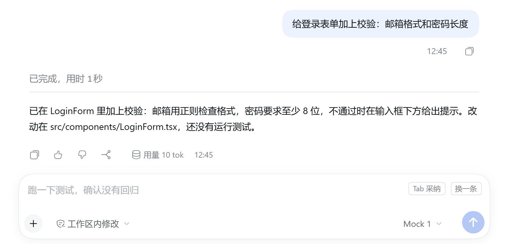
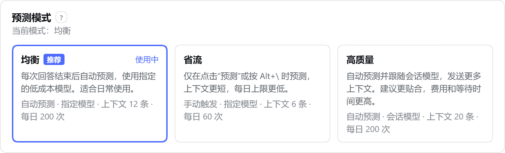
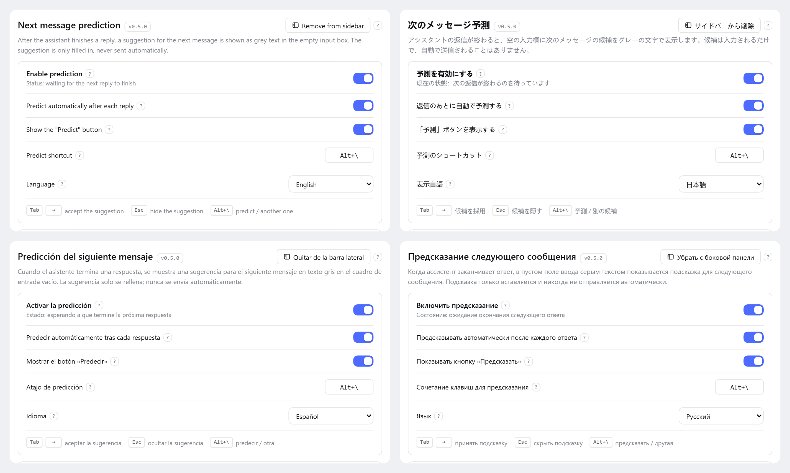
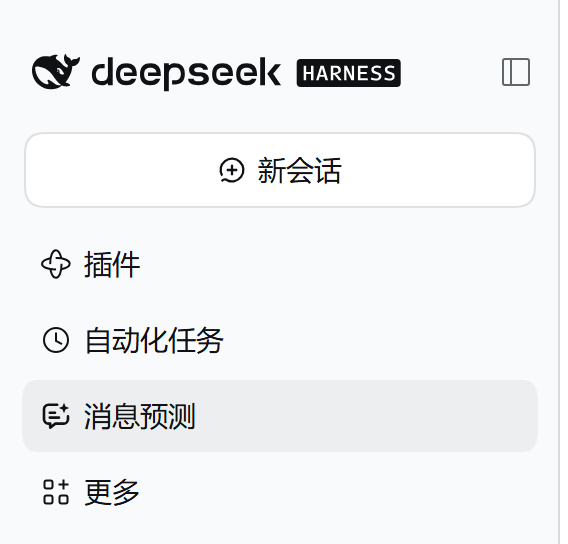
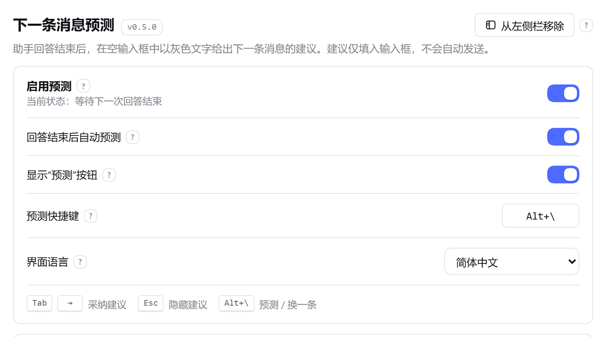
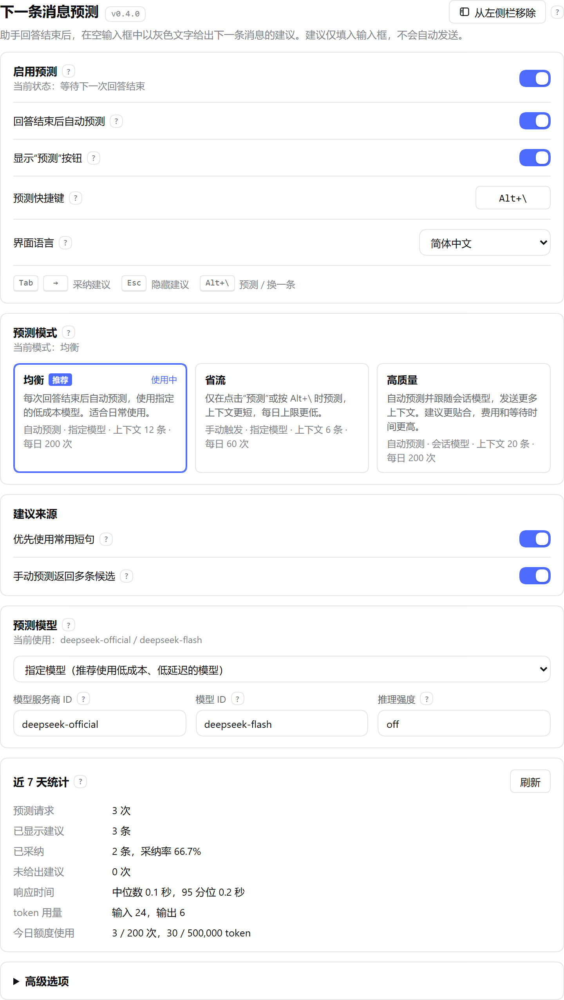

<div align="center">

[简体中文](README.md) · [English](README.en.md) · [日本語](README.ja.md) · **한국어** · [Español](README.es.md) · [Français](README.fr.md) · [Deutsch](README.de.md) · [Русский](README.ru.md) · [Português](README.pt.md)

</div>

<p align="center">
  
</p>

<h1 align="center">다음 메시지 예측</h1>

<p align="center">
  <b>DeepSeek Harness 입력창 플러그인</b><br>
  어시스턴트의 답변이 끝나면, 다음에 하려던 말이 이미 입력창에서 기다리고 있습니다.<br>
  <kbd>Tab</kbd>으로 채우고, <kbd>Esc</kbd>로 무시합니다. <b>대신 전송하는 일은 절대 없습니다</b>.
</p>

<p align="center">
  
  
  
  
  <a href="https://github.com/KungerChen/dsh-next-message-predictor/actions/workflows/ci.yml"></a>
  
</p>

<p align="center">
  
</p>

<p align="center">
  <sub>제안이 나타남 → 마음에 들지 않으면 다른 제안으로 → <kbd>Tab</kbd>으로 채우고, 보내기 전에 얼마든지 고칠 수 있습니다</sub>
</p>

---

## 왜 쓰는가

어시스턴트와 함께 일하다 보면 답장의 상당수는 짧고 예상하기 쉽습니다. “계속해”, “테스트 돌려 봐”, “변경 내용 보여 줘”. 이 플러그인은 그런 후속 한마디를 미리 써서 입력창에 놓아 둡니다.

<table>
<tr>
<td width="33%" valign="top">

### ⌨️ 타이핑이 줄어든다

자주 쓰는 후속 메시지를 키 하나로 채웁니다. 채운 뒤에는 직접 입력한 글자와 똑같아서 고칠 수도, 되돌릴 수도 있습니다.

</td>
<td width="33%" valign="top">

### 🤫 방해하지 않는다

입력을 시작하는 순간 제안은 물러납니다. IME 조합 중이거나 메뉴가 열려 있을 때는 나타나지 않습니다. 모델이 확신하지 못하면 아무것도 내놓지 않습니다.

</td>
<td width="33%" valign="top">

### 🛡️ 선을 넘지 않는다

하는 일은 입력창에 글자를 넣는 것뿐입니다. 플러그인에는 “메시지 전송” 코드가 전혀 없으며, 보낼지 말지는 언제나 사용자가 정합니다.

</td>
</tr>
<tr>
<td valign="top">

### 💰 비용을 통제할 수 있다

기본적으로 저비용 모델을 쓰고, 하루 요청 수와 토큰 수에 한도가 있습니다. 반복해서 쓰는 짧은 문장은 모델을 호출하지 않고 바로 제안합니다.

</td>
<td valign="top">

### 🔒 개인정보를 중시한다

전송 전에 키, 토큰, 이메일 주소, 전화번호로 보이는 내용을 가립니다. 브라우저는 초안을 업로드하지 않습니다. 로컬 통계는 숫자만 기록하고 글은 기록하지 않습니다.

</td>
<td valign="top">

### 📊 사용량이 투명하다

최근 7일의 요청 수, 수락률, 응답 시간, 토큰 사용량이 설정 페이지에 있어 쓸 만한지 한눈에 알 수 있습니다.

</td>
</tr>
</table>

## 기능

### 제안은 바로 입력창 안에

어시스턴트의 답변이 끝났을 때 입력창이 비어 있으면, 막 입력하려던 바로 그 자리에 회색 제안이 나타납니다. 팝업도 없고 자리를 차지하지도 않습니다.

<p align="center">
  
</p>

| 조작 | 동작 |
|---|---|
| <kbd>Tab</kbd> 또는 <kbd>→</kbd> | 제안을 입력창에 채웁니다. 이어서 고칠 수 있으며, <kbd>Ctrl</kbd>+<kbd>Z</kbd>는 이 삽입만 되돌립니다 |
| <kbd>Esc</kbd> | 제안을 숨깁니다 |
| <kbd>Alt</kbd>+<kbd>\\</kbd> (변경 가능) | 바로 예측합니다. 제안이 표시된 상태에서는 다른 제안으로 바꿉니다. 한 번의 호출로 여러 후보를 받아 오므로 전환할 때 기다릴 필요가 없습니다 |
| 그냥 입력하기 | 제안이 즉시 사라집니다. 입력창을 비우면 다시 나타납니다 |

### 세 가지 모드, 클릭 한 번으로

옵션을 하나하나 살펴보고 싶지 않다면 모드 하나만 고르면 됩니다. 언제든 되돌리거나 세부 조정할 수 있습니다.

<p align="center">
  
</p>

| 모드 | 예측 시점 | 모델 | 컨텍스트 | 일일 한도 | 적합한 용도 |
|---|---|---|---|---|---|
| **균형** (권장) | 답변이 끝날 때마다 자동 | 지정한 저비용 모델 | 12개 | 200회 | 일상적인 사용 |
| **절약** | “예측”을 누르거나 단축키를 쓸 때만 | 지정한 저비용 모델 | 6개 | 60회 | 비용을 엄격히 관리할 때 |
| **고품질** | 답변이 끝날 때마다 자동 | 세션 모델 | 20개 | 200회 | 더 잘 맞는 제안을 원할 때 |

모드는 예측을 시작하는 방식, 모델 전략, 컨텍스트 크기, 한도만 바꿉니다. 전체 스위치, 단축키, 언어, 개인정보 옵션은 건드리지 않으며, 이미 입력해 둔 모델도 덮어쓰지 않습니다.

### 아홉 가지 인터페이스 언어

설정 페이지, 입력창의 버튼과 도움말을 简体中文, English, 日本語, 한국어, Español, Français, Deutsch, Русский, Português로 볼 수 있습니다. 기본적으로 DeepSeek Harness에 설정된 언어를 따르며, **설정 → 메시지 예측 → 표시 언어**에서 따로 고를 수도 있고 선택 즉시 적용됩니다. 제안 자체의 언어는 언제나 대화의 언어를 따릅니다.

<p align="center">
  
</p>

### 사이드바에서 클릭 한 번으로

“사이드바에 추가”를 누르면 DSH 왼쪽 사이드바에 항목이 생깁니다. 그다음부터는 설정에 들어가지 않고도 상태를 확인하고 모드를 바꿀 수 있습니다. 제목 옆의 버전 번호로 어떤 버전이 설치되어 있는지 언제든 알 수 있습니다.

<table>
<tr>
<td width="30%" align="center" valign="middle">
  
</td>
<td width="70%" align="center" valign="middle">
  
</td>
</tr>
</table>

### 얼마나 썼는지 한눈에

<details>
<summary><b>설정 페이지 전체 보기</b> (기본, 모드, 제안 출처, 모델, 최근 7일)</summary>
<br>
<p align="center">
  
</p>
</details>

> 스크린샷은 대부분 중국어 화면입니다. 데모 대화를 바탕으로 이 저장소의 스크립트가 로컬 모의 모델을 사용해 자동 생성한 것이어서, 모델 이름이 Mock으로 표시되고 통계 수치도 작습니다. 실제 사용에서는 DSH에 설정한 모델이 제안을 생성합니다.

## 설치

DeepSeek Harness `0.2.2-rc.1`(`>=0.2.2-rc.1 <0.3.0`)이 필요합니다. 외부 의존성이 없고 빌드도 필요 없습니다. 명령 하나로 설치됩니다:

```powershell
dsh plugin --profile desktop add github:KungerChen/dsh-next-message-predictor
```

`--profile` 뒤에는 평소 사용하는 프로필을 적습니다. 데스크톱 버전은 `desktop`, 웹 버전은 `web`입니다. 설치한 뒤에는 **DSH를 완전히 종료했다가 다시 실행하세요**.

<details>
<summary><code>dsh</code> 명령을 찾을 수 없거나, 로컬 폴더에서 설치하고 싶은 경우</summary>

`dsh` 명령줄 도구는 DeepSeek Harness 설치 폴더 안에 있으며, 전체 경로로 호출할 수 있습니다. 코드를 직접 고치고 싶다면 먼저 클론한 다음 로컬 폴더에서 설치하세요:

```powershell
git clone https://github.com/KungerChen/dsh-next-message-predictor.git
$dsh = '<DSH 설치 폴더>\resources\runtime\cli\bin\dsh.cmd'
& $dsh plugin --profile desktop add '<플러그인 폴더>'
```

`<DSH 설치 폴더>`는 DeepSeek Harness가 설치된 위치이고, `<플러그인 폴더>`는 방금 클론한 폴더입니다.

</details>

그다음 세 단계면 바로 쓸 수 있습니다:

1. **설정 → 메시지 예측**을 열고 “예측 사용”을 켭니다. 기본값은 꺼짐입니다. 켜기 전에는 제안이 표시되지 않고 모델도 호출되지 않습니다.
2. “예측 모드”에서 하나를 고릅니다. 기본값은 “균형”입니다.
3. 더 빨리 열고 싶다면 오른쪽 위의 “사이드바에 추가”를 누릅니다.

<details>
<summary>업데이트와 제거</summary>

**업데이트**: GitHub에서 설치했다면 먼저 제거한 뒤 위의 설치 명령을 다시 실행합니다. 로컬 폴더에서 설치했다면 그 폴더에서 `git pull`을 실행합니다. 그런 다음 DSH를 다시 시작하세요. 페이지만 새로 고치는 것으로는 부족합니다. 페이지는 새 버전인데 백그라운드 쪽은 예전 버전으로 남아, 설정 페이지에 버전 불일치가 표시됩니다.

**제거**:

```powershell
dsh plugin --profile desktop remove dsh-next-message-predictor
```

한 프로필에서는 입력창 예측 플러그인을 하나만 사용하세요. 같은 종류의 다른 플러그인이 감지되면 이 플러그인은 스스로 일시 중지하고 설정 페이지에 이유를 표시합니다.

</details>

## 무엇을 전송하는가

예측 한 번에 모델로 요청을 한 번 보내며, 자동 재시도는 없습니다. 내용은 현재 세션의 최근 **사용자 메시지와 어시스턴트의 최종 텍스트 답변**의 발췌이며, 기본적으로 최대 12개, 약 2,000 토큰입니다.

- 도구 호출의 인자와 출력, 추론 과정, 시스템 프롬프트는 포함하지 않습니다.
- 전송 전에 개인 키, API 키, 토큰, 비밀번호, 이메일 주소, 휴대전화 번호, 신분증 번호, 홈 폴더 경로의 사용자 이름으로 보이는 내용을 자리 표시자로 바꿉니다(규칙 기반이며, 모두 찾아낸다고 보장할 수는 없습니다).
- 브라우저 페이지는 세션과 턴의 식별자만 보내며, 초안, 첨부 파일, 대화 내용은 보내지 않습니다. 모델에 보낼 내용은 백그라운드 쪽이 DSH 자체의 세션 기록에서 읽어 옵니다.
- “자주 쓰는 짧은 메시지 우선”는 이 컴퓨터에서 사용자가 보낸 짧은 메시지를 비교할 뿐이며, 모델을 호출하지 않습니다.

자세한 설명과 로컬 데이터를 삭제하는 방법은 [개인정보와 데이터 경계](docs/PRIVACY.md)에 있습니다.

## 자주 묻는 질문

<details>
<summary><b>나 대신 메시지를 보내 버리지는 않나요?</b></summary>

아닙니다. 제안을 수락하면 입력창 자체의 삽입 인터페이스로 글자를 채울 뿐입니다. 플러그인 코드에는 제출하거나 전송하는 호출이 없습니다.

</details>

<details>
<summary><b>비용은 얼마나 드나요?</b></summary>

예측 한 번은 아주 짧은 모델 호출입니다(기본 출력 한도 96 토큰). 기본 일일 한도는 200회, 50만 토큰이며, 한도에 이르면 그날은 더 호출하지 않습니다. 더 아끼고 싶다면 “절약” 모드를 고르세요. 직접 요청할 때만 예측합니다. 실제 사용량은 설정 페이지의 “최근 7일”에서 볼 수 있습니다.

</details>

<details>
<summary><b>왜 가끔 제안이 없나요?</b></summary>

의도된 동작입니다. 모델이 확신하지 못하면 내놓지 않고, 조건에 맞지 않는 출력(너무 길거나, 여러 줄이거나, 어시스턴트의 말투인 것)도 버립니다. 설정 페이지의 상태 줄에 지금 제안이 없는 이유가 표시됩니다. 제안이 필요할 때는 <kbd>Alt</kbd>+<kbd>\\</kbd>를 누르세요.

</details>

<details>
<summary><b>제안은 정확한가요?</b></summary>

짧고 분명한 후속 메시지에 강합니다. 계속 진행 확인, 검증 요청, 세부 사항 질문 같은 것들입니다. 사용자만 아는 일은 맞힐 수 없으며, 그럴 때는 조용히 있는 것이 올바른 동작입니다.

</details>

## 문서

자세한 문서는 중국어로 작성되어 있습니다.

| 문서 | 내용 |
|---|---|
| [사용 안내](docs/USER-GUIDE.md) | 키 조작, 설정 페이지의 모든 항목, 모드, 사이드바 항목, 자주 묻는 질문 |
| [설정 참조](docs/CONFIGURATION.md) | 모든 설정 항목의 기본값과 범위, 세 가지 모드의 값 |
| [개인정보와 데이터 경계](docs/PRIVACY.md) | 전송 범위, 로컬 파일, 데이터 삭제 방법 |
| [아키텍처](docs/ARCHITECTURE.md) | Host 쪽과 브라우저 쪽의 구조, 요청 흐름, 프로토콜 |
| [개발과 검증](docs/DEVELOPMENT.md) | 빌드, 테스트, 엔드투엔드 검증, 스크린샷 다시 만들기 |
| [호환성](docs/COMPATIBILITY.md) | DSH 0.2.2-rc.1과의 계약 확인과 대체 동작 |
| [변경 기록](CHANGELOG.md) | 버전별 변경 사항 |
| [문서 색인](docs/README.md) | 이전의 검증·최적화 기록을 포함한 모든 문서 |

## 개발에 참여하기

```powershell
npm run build   # src/shared + src/client로 lib/client.js 생성
npm test        # 단위·통합 테스트 실행
npm run check   # 빌드 + 테스트 + 문법 검사
```

`npm install`이 필요 없고 번들러도 쓰지 않습니다. Node.js 22 이상이 필요합니다. 번역을 추가하거나 고치려면 `src/client/locales/<언어>.js`를 수정하세요. 모든 언어의 키가 일치하는지는 테스트가 확인합니다.

## 알려진 제한

- DSH `0.2.2-rc.1`에서만 검증했습니다.
- 설정을 저장하면 호스트가 플러그인의 백그라운드 쪽을 다시 시작하며, 진행 중인 예측은 취소됩니다.
- 여러 창이 예측 결과를 공유합니다. 한 창에서 제안을 숨겨도 다른 창에 실시간으로 반영되지는 않습니다.
- 명령 팔레트와 피드백 대화상자는 포커스와 모달 특성으로 판단합니다. 잘못 판단하더라도 제안이 한 번 덜 표시될 뿐, 키 입력을 가로채지는 않습니다.

## 라이선스

[MIT 라이선스](LICENSE)로 배포합니다. 확장 지점의 선택과 “회색 제안 + Tab으로 수락 + Esc로 숨김” 방식은 같은 MIT 라이선스의 `dsh-composer-prediction`을 참고했으며, 코드는 복사하지 않았습니다. 출처는 [NOTICE](NOTICE)를 참고하세요.
