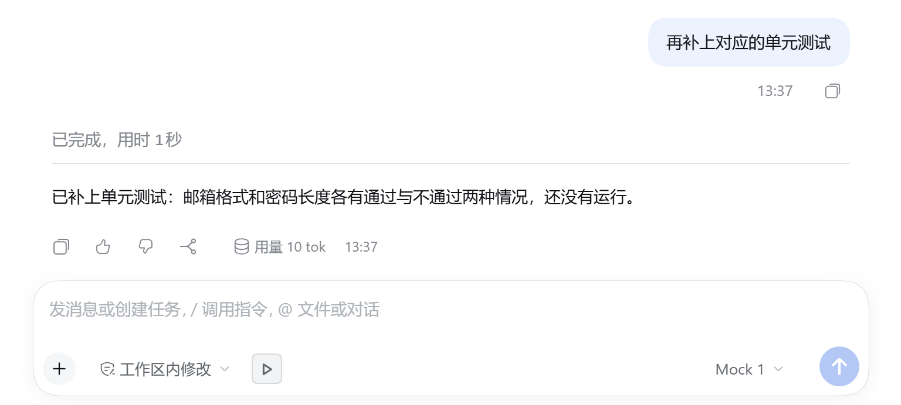
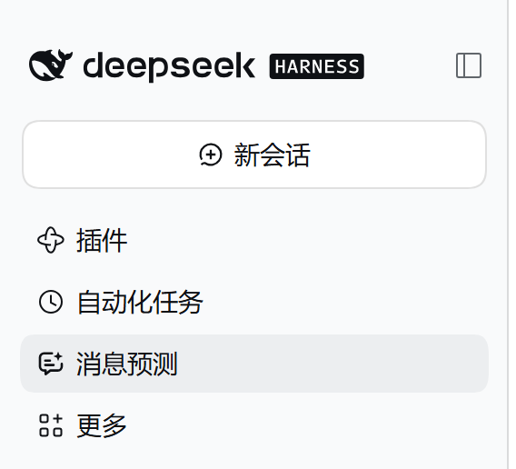

<div align="center">

[简体中文](README.md) · [English](README.en.md) · [日本語](README.ja.md) · [한국어](README.ko.md) · [Español](README.es.md) · [Français](README.fr.md) · [Deutsch](README.de.md) · [Русский](README.ru.md) · **Português**

</div>

<p align="center">
  
</p>

<h1 align="center">Previsão da próxima mensagem</h1>

<p align="center">
  <b>Um plugin para a caixa de entrada do DeepSeek Harness</b><br>
  Após uma resposta que atende às condições, uma sugestão para a próxima mensagem pode aparecer na caixa de texto.<br>
  Coloque o foco na caixa e pressione <kbd>Tab</kbd> para inserir a sugestão no rascunho. Você decide quando enviar.
</p>

<p align="center">
  
  
  
  
  <a href="https://github.com/KungerChen/dsh-next-message-predictor/actions/workflows/ci.yml"></a>
  
</p>

<div align="center">

[Início rápido](#quick-start) · [Visualizar e aceitar](#suggestions) · [Pausar uma conversa](#session-pause) · [Modos de previsão](#modes) · [Privacidade e chamadas ao modelo](#privacy) · [Documentação](#documentation)

</div>

<p align="center">
  
</p>

<a name="quick-start"></a>

## Início rápido

Instale no DeepSeek Harness `>=0.2.2-rc.1 <0.3.0`. O pacote do GitHub está pronto para uso, sem compilação.

```powershell
dsh plugin --profile desktop add github:KungerChen/dsh-next-message-predictor
```

Use o perfil que você abre no DSH (por padrão, `desktop` para o aplicativo e `web` para a versão web). Depois, **feche o DSH por completo e abra-o novamente**.

1. Abra **Configurações → Previsão**. A previsão vem desativada na primeira instalação.
2. Escolha um modo em “Modo”. Em “Modelo usado para prever”, confirme o provedor e o modelo configurados no DSH ou selecione “Seguir a sessão”. Salve as alterações nos campos do modelo.
3. Ative “Ativar previsão” e deixe a caixa vazia após a resposta. Para testar manualmente, clique em “Prever” ou coloque o foco na caixa vazia e pressione <kbd>Alt</kbd>+<kbd>\</kbd>.

Os modos equilibrado e economia usam `deepseek-official / deepseek-flash` por padrão. Para usar outro modelo específico, informe os IDs do provedor e do modelo no DSH. Se o modelo configurado não puder ser encontrado, o modelo padrão disponível do DSH pode ser usado nessa previsão.

<details>
<summary>O comando <code>dsh</code> não é encontrado, ou você quer instalar a partir de uma pasta local</summary>

A linha de comando `dsh` fica na pasta de instalação do DeepSeek Harness e pode ser chamada pelo caminho completo. Para alterar o código por conta própria, clone o repositório e instale a partir da pasta local:

```powershell
git clone https://github.com/KungerChen/dsh-next-message-predictor.git
$dsh = '<pasta de instalação do DSH>\resources\runtime\cli\bin\dsh.cmd'
& $dsh plugin --profile desktop add '<pasta do plugin>'
```

</details>

<details>
<summary>Atualizar e desinstalar</summary>

**Atualizar**: se você instalou pelo GitHub, desinstale e execute de novo o comando de instalação; se instalou de uma pasta local, execute `git pull` nela. Depois reinicie o DSH. Recarregar a página não basta: a página ficaria nova e a parte em segundo plano continuaria antiga, e a página de configurações avisaria que as versões não coincidem.

**Desinstalar**:

```powershell
dsh plugin --profile desktop remove dsh-next-message-predictor
```

Ative apenas um plugin de previsão para a caixa de entrada por perfil. Quando outro é detectado, este plugin se pausa sozinho e explica o motivo na página de configurações.

</details>

<a name="suggestions"></a>

## Visualizar e aceitar

Sugestões disponíveis aparecem em cinza na caixa vazia da janela ativa. Por padrão, elas podem aparecer mesmo quando a caixa está sem foco. Ative “Mostrar previsões apenas quando o campo de entrada estiver em foco” para exibi-las apenas com foco na caixa. Essa opção controla a exibição das sugestões já disponíveis.

<p align="center">
  
</p>

| Ação na caixa de texto | O que faz |
|---|---|
| <kbd>Tab</kbd>, <kbd>→</kbd> no início ou clique em “Tab para aceitar” | Coloque o foco na caixa primeiro. A sugestão passa para o rascunho e pode ser editada antes do envio. |
| <kbd>Esc</kbd> | Oculta a sugestão atual enquanto a caixa está em foco. Depois você pode pedir outra manualmente. |
| <kbd>Alt</kbd>+<kbd>\</kbd> (configurável), “Prever” ou “Outra” | Com a caixa vazia, solicita uma previsão ou muda de sugestão. O atalho também exige foco na caixa. |
| Simplesmente digitar | Digitar oculta a sugestão. Ao limpar o rascunho, ela pode reaparecer se ainda for válida. |

Depois de aceitar, use <kbd>Ctrl</kbd>+<kbd>Z</kbd> para desfazer e <kbd>Ctrl</kbd>+<kbd>Shift</kbd>+<kbd>Z</kbd> para refazer. A versão 0.6.0 corrige o desfazer da primeira inserção após o envio no editor testado do DSH Desktop `0.2.2-rc.3`. Outras versões usam o histórico nativo do DSH. [Relatório de validação](docs/VALIDATION-DISPLAY-SESSION.md)

<a name="session-pause"></a>

## Pausar uma conversa

Use o botão de pausa na barra da caixa para parar as previsões automáticas e manuais nesta conversa e ocultar a sugestão. Clique em ▶ para retomar. Depois, peça uma previsão ou aguarde a próxima resposta.

<p align="center">
  
</p>

Janelas ligadas ao mesmo host DSH compartilham a pausa. Ela continua após recarregar a página ou salvar configurações, até você retomar ou reiniciar o DSH. Aceitar ou ocultar uma sugestão também oculta as sugestões daquele turno nas outras telas da conversa.

<a name="modes"></a>

## Modos de previsão

<p align="center">
  
</p>

| Modo | Quando prevê | Modelo | Máx. de mensagens de contexto | Limite diário de solicitações |
|---|---|---|---|---|
| **Equilibrado** (Recomendado) | Automática após uma resposta elegível | Modelo específico | 12 | 200 |
| **Econômico** | Apenas manual | Modelo específico | 6 | 60 |
| **Qualidade** | Automática após uma resposta elegível | O modelo da sessão | 20 | 200 |

Os modos ajustam quando prever, a estratégia de modelo, o contexto e os limites. Eles preservam o controle geral, o atalho, o idioma, as opções de privacidade e os IDs de modelo informados.

### Sugestões do modelo e frases próprias

Após as sugestões do modelo, podem aparecer mensagens curtas que você repetiu nesta conversa e suas frases fixadas. Adicione ou reorganize frases em **Configurações → Previsão → Origem das sugestões → Frases fixadas** e salve. “Outra” alterna entre as opções disponíveis sem outra chamada ao modelo. Quando as opções acabarem, pedir outra pode fazer uma nova chamada ao modelo, respeitando os limites.

Se o modelo não der um resultado utilizável para uma solicitação manual, o plugin pode oferecer suas frases, se houver. Gerar essa alternativa não requer outra chamada ao modelo.

<p align="center">
  
</p>

## Configurações e uso

A interface tem nove idiomas e acompanha o DSH por padrão. Você pode escolher outro em “Idioma” nas configurações do plugin.

Clique em “Adicionar atalho à barra lateral” para abrir Previsão pela barra lateral esquerda do DSH. Se desafixar o atalho, você pode abri-lo ou fixá-lo novamente em “Mais”. A versão instalada aparece ao lado do título.

<table>
<tr>
<td width="30%" align="center" valign="middle">
  
</td>
<td width="70%" align="center" valign="middle">
  
</td>
</tr>
</table>

“Últimos 7 dias” mostra solicitações, sugestões exibidas e aceitas, tempo de resposta e consumo de tokens.

<details>
<summary><b>Ver a página de configurações inteira</b> (básico, modos, origem das sugestões, modelo, últimos 7 dias)</summary>

<p align="center">
  
</p>

<p align="center">
  
</p>

</details>

> As capturas foram feitas em uma interface web isolada, com uma conversa sintética e um modelo simulado local. As configurações são exemplos. Os números de uso e tempo de resposta são ilustrativos.

<a name="privacy"></a>

## Privacidade e chamadas ao modelo

Uma previsão por modelo envia trechos recentes de **mensagens do usuário e respostas finais do assistente** da ramificação atual a um provedor configurado no DSH. O limite padrão de entrada é de 12 mensagens e cerca de 2000 tokens, incluindo as instruções de previsão.

- Por padrão, inclui um breve resumo das contagens de atividades do turno anterior. Argumentos e saídas de ferramentas, raciocínio e instruções do sistema ficam de fora.
- O mascaramento por regras vem ativado. Ele substitui possíveis segredos e alguns identificadores pessoais, mas pode deixar passar texto sensível.
- As solicitações de previsão e estado do navegador carregam identificadores e metadados. O backend lê as mensagens já enviadas no DSH. Rascunhos, anexos e referências ficam de fora. As estatísticas locais guardam contagens, tempos e identificadores, sem o texto de conversas ou sugestões.
- As opções locais e a lista de frases fixadas não são adicionadas ao prompt do modelo. Uma frase já enviada como mensagem pode aparecer no contexto recente.

A descrição completa, e como apagar os dados locais, está em [Privacidade e limites dos dados](docs/PRIVACY.md).

## Perguntas frequentes

<details>
<summary><b>Por que não apareceu nenhuma sugestão?</b></summary>

Veja o estado atual nas configurações. Uma conversa pausada, janela inativa, rascunho não vazio, menu aberto ou composição por IME podem impedir a exibição. O modelo também pode não retornar uma sugestão válida. Em uma conversa elegível, tente a previsão manual com a caixa vazia e em foco.

</details>

<details>
<summary><b>Quando uma solicitação é cobrada?</b></summary>

O custo depende do provedor chamado e dos tokens usados. Alternar entre opções existentes e montar uma alternativa local não adicionam solicitações ao modelo. Use o modo economia para pedir previsões quando precisar.

</details>

<a name="documentation"></a>

## Documentação

A documentação detalhada está escrita em chinês.

| Documento | Conteúdo |
|---|---|
| [Guia de uso](docs/USER-GUIDE.md) | Teclas, cada item da página de configurações, modos, o item da barra lateral, perguntas frequentes |
| [Referência de configuração](docs/CONFIGURATION.md) | Valores padrão e intervalos de todas as opções, valores dos três modos |
| [Privacidade e limites dos dados](docs/PRIVACY.md) | O que é enviado, arquivos locais, como apagar os dados |
| [Compatibilidade](docs/COMPATIBILITY.md) | Versões do DSH, cobertura dos testes e interfaces do host |
| [Registro de alterações](CHANGELOG.md) | Mudanças de cada versão |
| [Índice da documentação](docs/README.md) | Todos os documentos, incluindo notas anteriores de verificação e otimização |

## Contribuir

```powershell
npm run build
npm test
npm run check
```

O desenvolvimento requer Node.js 22 ou posterior. Não há dependências de execução para instalar. `npm run check` verifica o pacote cliente, os README gerados, os testes e a sintaxe JavaScript. [Desenvolvimento e verificação](docs/DEVELOPMENT.md) · [Arquitetura](docs/ARCHITECTURE.md)

## Licença

Publicado sob a [licença MIT](LICENSE). A escolha dos pontos de extensão e a interação “sugestão cinza + Tab para aceitar + Esc para ocultar” foram inspiradas no `dsh-composer-prediction`, também sob licença MIT; nenhum código dele foi copiado. Veja [NOTICE](NOTICE).
